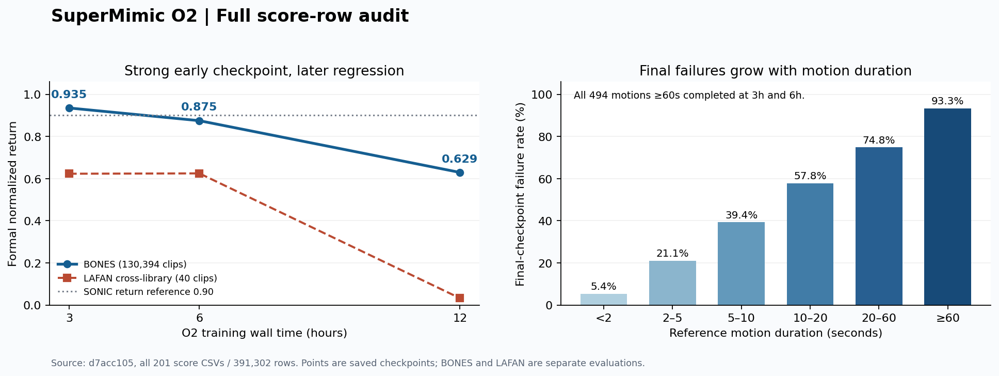

# O2 官方完整 BONES 复核与下一步判断

日期：2026-11-12（北京时间）。复核固定用户仓库提交 [d7acc105](https://github.com/kaiwen123-yang/Supermimic/commit/d7acc105accfeca663a2341a846d527dbd10c28b)，实际官方 SuperMimic 为 abc124c1bd5976341034668af3d12c087f2f1f55，研究环境为 dd51a9fcc98791a2f0b018b3c7f71a3eefd5ecdd。此次只读取已发布结果与代码、整理复核和 O3 方案，没有连接 D57、重评模型或启动 O3。

## 1. 本轮结论

**官方完整 BONES 已经跑出高质量基线：3h 节点 R=0.93501955，130215/130394 条完整，超过论文 SONIC 的0.90回报参照。后续训练出现明显质量回撤，12h终点发生大范围失败。** 因此保护3h为当前质量锚点，6h保留为困难覆盖参照；下一段从3h权重开展匹配的固定学习率对照。

O2 的训练、三节点两种动作库的全部评分和轻量发布确已完成。summary 顶层 completed 与训练退出快照 latest_training.status=training_completed_evaluation_pending 不矛盾；退出快照不是后续评分的当前状态。已发布 conclusion 原先只突出 final，容易掩盖3h成果，本次补充完整轨迹解释。

已有 O1/P6 的 LAFAN1 达标结论保留。对 BONES，本轮可明确记录“项目完整库回报超过论文 SONIC 参照”；作者单卡25失败及持续训练稳定性仍有差距，数据成员未对齐时不宣称严格同成员 benchmark 等价。

来源：[原始summary](../results/20261111-o2-official-bones-s0/summary.json)、[本轮机器可读复核](../results/20261111-o2-official-bones-s0/review_20261112.json)。

## 2. 阅读和数值复核范围

本次重新读取并逐行复核 **201个正式评分CSV、391302行**：BONES三节点各130394行，LAFAN三节点各40行。核对原source ID覆盖、重复和缺失、跨节点身份/参考长度、N−1、执行数、分母、R、完整标志及质量汇总。三个BONES节点均覆盖0…130393，无重复或缺失。R/分母/完成比例行级重算误差为0；与已发布summary的均值差异约1e−14；逐奖励项归一化后求和与R的最大差异约3e−8，符合float32逐项与总奖励累计的舍入差异。

另外读取实际配置、数据转换记录、训练/评分入口、评分中断记录、三对节点比较，以及8条final真实失败窗口。训练日志共保存3258份快照，本次按collection顺序每10份取1份并加末份，共327份；这些是最后一次update的快照，**不是完整优化历史，也不是日志区间均值**。本次未新增仿真或网络推理。

完整衍生数据：
- [全部逐clip复核与179条父失败明细](../results/20261111-o2-official-bones-s0/review_per_clip_20261112.json)
- [训练快照分段统计](../results/20261111-o2-official-bones-s0/training_diagnostics_20261112.json)
- [8条已有失败窗口几何量](../results/20261111-o2-official-bones-s0/failure_window_geometry_20261112.json)

## 3. 三个节点说明了什么

### 3.1 全库结果

| 节点 | 新run训练时间 | 联合更新数 | BONES R | 完整 / 130394 | 失败 | hard完整 /639 | LAFAN跨库 R | LAFAN完整 /40 |
|---|---:|---:|---:|---:|---:|---:|---:|---:|
| 3h | 10800.264s | 31924 | 0.93501955 | 130215 | 179 | 552 | 0.62306608 | 25 |
| 6h | 21600.246s | 64746 | 0.87472977 | 129997 | 397 | 597 | 0.62468111 | 26 |
| final | 43200.009s（保存节点） | 130314 | 0.62929250 | 83910 | 46484 | 127 | 0.03270170 | 0 |

训练退出统计为43200.161s、325793次collection、1334448128个真实transitions、1303140次WM batch更新及2606280次Critic minibatch更新。collection、联合更新和WM batch更新是不同单位，不能直接拿325793去对应论文320000 iterations。

正式R为逐clip原生reward sum / [0.1×(N−1)]，失败尾段保留在分母，再对全部clip等权平均。下文质量均值均沿用已有返回后状态与推进后参考的口径。

### 3.2 3h→6h：困难覆盖提高，普通质量退步

| 分组 | 3h完整 | 6h完整 | final完整 |
|---|---:|---:|---:|
| flip（44） | 28 | 33 | 5 |
| side_roll（22） | 15 | 15 | 1 |
| cartwheel（120） | 116 | 119 | 6 |
| handstand（160） | 159 | 156 | 0 |
| 固定hard639 | 552 | 597 | 127 |

3h→6h新增122条完整、丢失340条，57条两节点都失败。**110331条动作的R下降，占全库84.61%。** 在两节点都完整的129875条上，R从0.93610564降至0.87655575，XY从0.106098m升至0.216597m。共同完整集合排除了“只是失败尾段拉低均值”的解释：大范围跟踪质量在大规模失败之前已经回撤。

与此同时hard完整数增加45，flip与cartwheel覆盖改善。因此6h不是所有能力都变差，而是困难覆盖与整体质量出现取舍。3h倒立159/160完整也是覆盖成绩；其组R仅0.59241、身体相对姿态误差均值0.86761rad，不能把完整执行直接等同于高精度倒立跟踪。

### 3.3 12h：普遍质量和长时稳定性回撤

3h→final新增33条完整、丢失46338条；**129749条R下降，占99.51%**。共同完整83877条的R从0.94821765降至0.79196393，XY从0.085434m升至0.445862m。全库平均XY则从0.106204m升至0.459655m。

BONES按参考时长分组的final失败率：

| 参考时长 | 动作数 | final失败数 | 失败率 |
|---|---:|---:|---:|
| <2s | 1591 | 86 | 5.41% |
| 2–5s | 49538 | 10440 | 21.07% |
| 5–10s | 57353 | 22583 | 39.38% |
| 10–20s | 18309 | 10587 | 57.82% |
| 20–60s | 3109 | 2327 | 74.85% |
| ≥60s | 494 | 461 | 93.32% |

这494条≥60s动作在3h和6h时均全部完整执行。后期长时失败不能解释为早期模型本来就没有长程执行能力；这里是已学能力的回撤。

## 4. 还剩哪些困难

3h的179条失败由 **hard639内87条、其余92条**组成；类别主要为Stunts82、Advanced Locomotion23、Gestures23、Basic Locomotion Neutral13、Unusual Locomotion10、Baseline9、Sports/Complex Actions/Dancing各6、Object Manipulation1。hard集合并不包含全部失败，下一段不能仅盯着hard均值而忽略普通动作。

| 节点 | 仅根高度anchor_pos | 仅姿态anchor_ori | 两者同时 |
|---|---:|---:|---:|
| 3h | 117 | 61 | 1 |
| 6h | 355 | 42 | 0 |
| final | 38859 | 6614 | 1011 |

官方anchor_pos只检查高度，不是XY位置；官方SuperMimic任务也移除了ee_body_pos终止。故“完整”不要求全局XY或每个身体姿态误差都小。这是既定官方条件，不在本轮改阈值。

8条已保存的final尾窗证实真实控制偏离，例如handstand_0的根高度差由−0.154910m扩大至−0.254949m；cartwheel_0的根SO3误差由0.151921rad升至1.338264rad。这些是终点模型自身真实轨迹，不是WM预测。它们可以说明失败形态，但不能单独定位训练中的根因。窗口状态与native奖励/终止保留各自既定时序，不由后验几何量重新定义失败。

下一段固定跟踪原3h的179条失败与3h/6h共同失败的57条，名单只用于报告，不据此改变训练配额。

## 5. LAFAN结果怎么理解

O2从零只训练BONES，未载入O1权重。LAFAN的25→26→0是这一个BONES模型的跨库表现，不能写成O1发生遗忘；O1自己的40/40成绩仍成立。

BONES平均每条参考时长约7.30s，LAFAN约220.55s，长度相差约30.2倍。跨库结果同时混合动作分布和长时控制差异。LAFAN final仅执行20638/441100个参考转移，平均完成比例5.02%；其失败前缀XY均值低于3h不代表精度改善。应看共同完整集合、完整数和全部分母下的R。3h与6h共同完整24条的R为0.79210→0.78140。

## 6. 代码审计发现与排除范围

### 6.1 未发现可直接解释回撤的接线错误

O2训练外壳保留官方 self.step → WM.update → policy.update、Ratio=.4、原normalizer更新与return sampler。实际数据转换保留全130394条、47727908帧及坐标/关节映射，训练直接使用作者packed loader。

评分逐checkpoint重载Actor和WM bundle/normalizer，Actor.eval；每批重置物理状态、参考起点和10帧历史；padding/inactive不计分，所有done行履行manual reset。正式评分不调用学习到的wm.dynamics，Critic不参与推理，WM对象只提供解析representation/goal接口。**分数回撤直接表现为保存Actor及其normalizer的真实控制退化；训练时WM、Critic、sampler的间接作用仍可能存在。**

实际曾发生一次评分reset对inference tensor进行原地更新的RuntimeError，修复为整段score_batch运行在inference_mode内，保留第一批4096条后接续缺失批次。没有重启训练，全部后续评分完成，未发现该中断造成成绩错误。

依据：[训练外壳](../scripts/o2/train_official.py)、[评分器](../scripts/o2/evaluate_library.py)、[指标](../scripts/o2/metrics.py)、[评分中断记录](../results/20261111-o2-official-bones-s0/evaluation_interruption_20261112.json)。

### 6.2 训练代理指标与真实控制表现脱节

327份抽样快照的分段中位数：

| 时段 | WM Loss/state | Policy/reward | Critic fitting loss |
|---|---:|---:|---:|
| 0–3h | 0.0142426 | 13.50696 | 0.0128050 |
| 3–6h | 0.0112149 | 13.95568 | 0.0084714 |
| 6–12h | 0.0108316 | 14.45740 | 0.0063020 |

抽样中没有非有限值或明显晚期scalar loss爆炸；最大Actor梯度范数10.66369出现在2.864h，早于优秀的3h节点。不能据此排除所有未抽到的瞬间异常，但当前证据不支持“训练根本没学会”“WM训练loss发散”或“继续加时自然能解决”。

Policy/reward包含Critic终端bootstrap，并除以horizon×dt；它不是正式归一化R。WM短窗loss也只反映当时replay分布上的局部拟合。它们变好而正式成绩变差，提示需要将真实采集表现、想象dense reward、bootstrap、采样覆盖与normalizer状态分开记录，不能只看现有loss曲线判断训练有效。

### 6.3 官方当前源码与论文历史配方不同

论文Table A.5给出Adam与cosine衰减至0.03×；当前官方main为隐藏线性权重Muon、其他参数Adam，固定2e−4，没有同名scheduler。O2没有漏调用一个上游已存在的schedule。本轮是当前官方源码基线，不能把历史论文表格直接套在当前实现上。

Muon的Python float LR会固化在CUDA graph内。下一段固定低LR必须在构建learner/capture前设置；只给Adam改param_group或capture后套Python scheduler不等于所有参数都正确衰减。

官方历史 [76be1c9](https://github.com/HybridRobotics/supermimic/commit/76be1c95fbbfeee3ec9728ebb5a9b4cbe2198fc4) 曾记录Actor-Critic先收敛后失稳，后续 [f496d3c](https://github.com/HybridRobotics/supermimic/commit/f496d3c6bca21c448356fd6f11feeec42b2c9b66) 将当时现象关联到Critic输入normalization并移除。当前Critic已经没有该normalizer，O2快照也未显示相同的value loss爆炸；这些历史支持补价值项诊断，不证明旧bug仍在。

实际运行依赖rsl-rl-lib5.5.2的normalizer使用int64 count及累计均值/方差，默认until=None。没有“float32 count饱和”的证据；没有权重内统计摘要时，也不能把本次回撤归因于normalizer。源码另有GenCoord合成proprio未加入encoder bias、真实proprio带bias的静态差异，但3h时也存在，不能单凭它解释晚期变化，O3不同时改这一变量。

依据：[论文v2](https://arxiv.org/pdf/2610.28480v2)、[当前优化器](https://github.com/HybridRobotics/supermimic/blob/abc124c1bd5976341034668af3d12c087f2f1f55/src/supermimic/learners/learner_utils.py)、[当前Policy learner](https://github.com/HybridRobotics/supermimic/blob/abc124c1bd5976341034668af3d12c087f2f1f55/src/supermimic/learners/policy_learner.py)、[实际版本normalizer](https://github.com/leggedrobotics/rsl_rl/blob/v5.5.2/rsl_rl/modules/normalization.py)。

## 7. 与论文还差什么

论文Figure3的0.90是SONIC回报参照；SuperMimic的精确单卡3h回报小数并未在正文给出。O2 3h已经超过这个回报参照，但179失败高于作者单卡25/129514；恰好同为179也不代表与SONIC失败集合相同。作者双卡9.8h零失败另列，不能把本项目单卡12h视为同资源对照。

论文叙述3h之后保存节点仍持续领先SONIC，而O2 6h与final均落到0.90以下，持续训练稳定性是本轮明确未重现的性质。现有130394条与作者129514条未逐成员对齐；不任意删880条来凑总数。作者主结果究竟对应何种历史GenCoord/MaxCoord精确run配置也未取得，当前任务名称不自动证明完全复原论文配方。

**本轮的合理下一步是先保住已达到的整体质量，同时继续提升困难覆盖。** 把最终低分当作全部成果失败、从final盲目延长、同时切换optimizer/表示/配额/窗口，都会削弱下一轮结果的解释力。

## 8. O3决策

从O2 3h checkpoint_000079816.pt共同加载三网络及normalizer，设置两路固定LR：control=2e−4，quarter=5e−5。两路optimizer/replay/sampler/RNG均新建，因此是匹配的权重热启动，不是full resume；原LR控制支用于控制共同重建状态的影响。

各新增最多32000联合更新，整个campaign共享8h训练墙钟。保存+8k/+16k/+32k与实际final；两个训练子进程均退出后串行全库评分。按相同新增更新数比较全部R、失败、hard/普通/长动作与共同完整质量。原3h和6h结果直接引用，不重评。

若低LR更好，只能说明本seed相同热启动条件下减小固定步长有收益；不能认定它是O2唯一根因。若两路都好，不能把共同的优化器/replay重建效应归给低LR。若两路都回撤，按本轮新增证据继续定位，不能自动加预算。失败减少而R下降时，应报告覆盖与质量取舍。

执行细节见 [O3方案](O3_OFFICIAL_BONES_STABILITY_PLAN.md)、[固定协议](../configs/o3_official_bones_stability_protocol.json)、[Codex启动词](O3_CODEX_START_PROMPT.md)。当前仅发布这些材料，O3尚未实施或启动。

