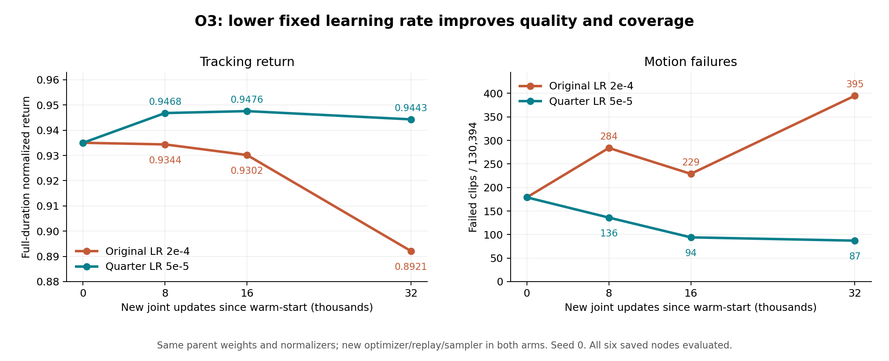

# O3完成复核：低学习率有效，较长连续训练仍需验证

复核日期：2026-11-13。固定结果提交：[b79dfbaffc3175d907dbe94bed74175968b5f50d](https://github.com/kaiwen123-yang/Supermimic/commit/b79dfbaffc3175d907dbe94bed74175968b5f50d)。官方main复查仍为[abc124c1](https://github.com/HybridRobotics/supermimic/tree/abc124c1bd5976341034668af3d12c087f2f1f55)，本轮没有需要追随的新上游算法版本。

**结论：O3成功完成了有判别力的固定学习率对照。三网络LR从2e-4降到5e-5，在相同32000新更新下显著改善了正式回报、完成数和共同完整动作的跟踪质量。下一步选quarter final作为主父，单路完成132000次新的连续联合更新，检验更长过程；尚不能宣布长期回撤彻底解决或论文全部实验复现完成。**

O3训练、六个唯一权重节点的BONES与LAFAN评分、轻量发布均已完成。O4目前只发布方案与启动提示词，没有在D57启动。O1/P6的LAFAN验收以及O2/O3已保存成绩继续有效，P12暂缓。

## 1. 本轮完整成绩

BONES固定为项目130394条，R按完整参考时长归一化，提前失败的尾部计零；不是只对执行过的前缀计分。initial复用父O2 3h成绩，final是各自32k的文件别名。

| 节点 | 新联合更新 | BONES R | 完整 / 130394 | 失败 | hard完整 / 639 | LAFAN跨库R / 完整 |
|---|---:|---:|---:|---:|---:|---|
| O2 3h父 | 0 | .93501955 | 130215 | 179 | 552 | .62306608 / 25 |
| control | 8000 | .93437496 | 130110 | 284 | 512 | .62983564 / 23 |
| control | 16000 | .93016247 | 130165 | 229 | 524 | .64029852 / 26 |
| control final | 32000 | .89208292 | 129999 | 395 | 542 | .58545054 / 22 |
| quarter | 8000 | .94680545 | 130258 | 136 | 557 | .65155078 / 26 |
| quarter | 16000 | **.94757578** | 130300 | 94 | 594 | .63926816 / 24 |
| quarter final | 32000 | **.94430475** | **130307** | **87** | **597** | .64036472 / 23 |

来源：[正式summary](../results/20261112-o3-official-bones-lr-s0/summary.json)、[全部逐clip入口](../results/20261112-o3-official-bones-lr-s0/README.md)。

两路都实际完成80006次collection、327704576条真实transition、32000次联合更新、320000次WM batch更新、640000次Critic minibatch更新，约6h12m22s，停止原因为更新数上限。没有8h期限导致的更新量不等。两个训练child退出后再完成12份正式库评分；历史endpoint中的evaluation_pending仅代表训练退出瞬间，并非尚有评分未完成。

## 2. 为什么可以认为低LR这组干预有效

两份实际config的全部差异只有run/arm身份与三网络学习率。初始WM/Actor/Critic来自同父，active normalizer的count及统计摘要一致，LR在构造learner/optimizer/CUDA graph前设置；实际Adam/Muon都取得目标LR。共同patch仅统计已计算的detached值，没有额外forward、physics或随机抽样。

这里是同父、同配置seed的对照，不是逐位完全相同的随机轨迹。第一次尚未更新的collection已经存在小数值和motion_end差异，不声称common random numbers或逐样本配对。固定原始clip身份的正式评估仍可逐条比较。

在相同32k更新下，quarter相对control：

- R提高 **.05222183**，失败 **395→87**，净少308条，约77.97%。
- 364条从control失败变为quarter完整，同时56条反向变化；不是quarter包含control所有成功。
- **123971/130394（95.07%）**动作R更高，说明优势相当广泛。
- 两路共同完整的**129943条**上，R **.89376304→.94501760**，XY误差 **.15916211→.07176143m**，约降低54.91%；相对身体姿态误差 **.14712135→.09986864rad**。

共同完整集合排除了“只是不同失败尾部让均值看起来更好”的解释。可得结论是**三网络统一降低固定LR，在本次warm-start过程里更有效**。由于WM/Actor/Critic三者LR同时降低，不能据此区分究竟哪一个网络是O2回撤的唯一根因，也不把O2 6h当严格匹配control。

来源：[32k官方适配逐clip对照](../results/20261112-o3-official-bones-lr-s0/paired/update_32000/bones_full/comparison.json)、[本次全部派生统计](../results/20261112-o3-official-bones-lr-s0/review_per_clip_20261113.json)。

## 3. quarter仍有质量回撤和能力交换

### 3.1 16k到32k不是单调改善

quarter失败数94→87，但实际上**69条新增完整、62条新丢失、25条持续失败**。全库85665条（65.70%）R下降，回报变化中位数−.00349657。两个节点共同完整130238条上，R **.94814489→.94487848**，XY **.0706206→.0718365m**。

全库相对身体姿态误差也由.09366772增至.10033849rad。因此，“失败净减少7条”不能表述为所有质量持续上升。保留**quarter16k质量锚**与**quarter32k覆盖锚**；选32k作下一父节点，是为了继续较后阶段、覆盖更广的模型，并非认定它所有指标都最好。

### 3.2 剩余87条的来源

相对O2 3h的179失败，quarter final恢复147条，仍失败32条；同时有55条父模型原本完整的动作新失败。旧3h/6h共同失败57条中，39条已恢复、18条仍失败。最终87为**hard42 + non-hard45**。

| 最终失败原因 | 数量 |
|---|---:|
| anchor_pos | 69 |
| anchor_ori | 17 |
| 两者同时 | 1 |

官方这里的anchor_pos是根高度z条件，不是XY距离或全三维位置阈值。不能将其直接解释成“69条因为横向漂移而失败”。

类别为Stunts24、Sports19、Advanced Locomotion17、Gestures9、Unusual Locomotion6、Dancing5、Basic Locomotion Neutral3、Complex Actions2、Baseline2。失败clip的参考动作时长为2–5s的26条、5–10s的47条、10–20s的13条、20–60s的1条；这不是首次失败发生时间。**参考时长≥60s的494条动作仍全部完整**。尚未重现O2最终长动作大面积失败，但O3新过程只有32k更新。

### 3.3 技能分项必须和姿态质量一起看

| 技能 | O2 3h父 | quarter8k | quarter16k | quarter32k |
|---|---:|---:|---:|---:|
| flip / 44 | 28 | 41 | 38 | **42** |
| side_roll / 22 | 15 | 18 | 21 | **21** |
| cartwheel / 120 | 116 | 117 | 118 | **114** |
| handstand / 160 | 159 | 118 | 144 | **148** |

翻转、侧滚提升很明显；倒立与侧手翻尚未保住父覆盖。quarter final的12个倒立失败**全部来自父已完成动作的新丢失**，父原来唯一的倒立失败反而恢复了。

倒立16k→32k新增10条完整、失去6条，净增加4；但两点共同完整138条倒立的R **.58074975→.53791008**，身体相对姿态误差 **.88111661→.99887520rad**。即使没有触发原终止，姿态跟踪仍有明显差距。下一轮不能只用“148/160”来判断倒立改善。

固定成员和每条实际数据已保存到[O4分析组](../configs/o4_fixed_analysis_groups.json)。这些集合只用于评估分母，不改变训练采样。

## 4. 新诊断缩小了什么疑点

本次读取全部82个训练统计分片、每路8002个日志窗口。collection/reset是窗口求和；loss、dense/bootstrap、value/GAE是日志时刻的最后一次联合更新快照，不是所有更新的完整均值/极值。

| 全段统计 | control | quarter |
|---|---:|---:|
| 真实训练reward / transition / 0.1 | .82186913 | .86858408 |
| WM loss快照中位 | .01222530 | .00605110 |
| Critic loss快照中位 | .00924159 | .00654447 |
| 想象dense return快照中位 | 2.39167 | 2.47197 |
| 想象bootstrap return快照中位 | 6.61540 | 6.67552 |
| bootstrap占比快照中位 | 73.4197% | 72.9641% |
| hard639实际reset占比 | 45.1351% | 46.8906% |

低LR组的真实采样reward、WM和Critic拟合统计更好，与正式评估方向一致。不过训练数据是各自策略产生的不同分布，WM loss差距不是相同输入上的模型误差对拍，不能仅凭它确定机制。

**当前不支持直接新增hard quota。** hard639虽只占全库约0.49%的clip，官方自适应sampler已将quarter约46.89%的reset分给它们。reset曝光不等同于WM训练窗或Actor起点曝光，但至少不能说这些动作因为数量少就几乎没练过。quarter的训练硬终止735674次，高于control549219次，与正式成绩更好并不矛盾：训练含噪声、随机起点和自适应分布，不能把这些计数当正式全库失败率。

末8k更新中，bootstrap raw value超10比例的快照均值为control **1.6021%**、quarter **.05295%**；GAE目标超上界比例为 **.4320%/.01443%**。control更频繁触碰价值上界，但已发布快照没有value/loss非有限值，bootstrap占比稳定约73%，也没有巨大数值发散。因此证据支持低LR改善闭环，**尚不足以把Critic价值爆炸定为唯一根因**。

梯度最大快照control150.29、quarter25.38来自裁剪前的`clip_grad_norm_`返回值；不能将其当作实际未裁剪更新幅度，也不是覆盖全部更新的极值。当前没有发现必须先改官方算法才能启动下一段的确定bug。

来源：[训练诊断派生统计及实现核对](../results/20261112-o3-official-bones-lr-s0/training_diagnostics_review_20261113.json)、[control实际配置](../results/20261112-o3-official-bones-lr-s0/arms/control/actual_config.json)、[quarter实际配置](../results/20261112-o3-official-bones-lr-s0/arms/quarter/actual_config.json)。

## 5. Normalizer与旧O2补充证据

两路active normalizer count均从326926336增至654630912，正好等于父统计加新增真实transition；未见重置、NaN或std塌缩。unused velocity normalizer count=0符合仅motion目标的路径。统计范数/分位有变化，但这些摘要不足以证明所有坐标漂移无害或证明它是回撤根因。

O3准备阶段已经补充发布O2三个节点的CPU normalizer读取，以及既有32580条console记录抽取的122条：

- [O2 normalizer摘要](../results/20261111-o2-official-bones-s0/o3_preparation_normalizers.json)。
- [O2已有真实训练日志摘录](../results/20261111-o2-official-bones-s0/o3_preparation_existing_real_metrics.json)。

O2 active count326926336→663023616→1334448128，未见明显计数重置或方差崩溃。历史logger的episode统计主要按hard-reset结束刷新，不能与O3所有done原因的episode均值直接横比。O2仍缺完整dense/bootstrap、raw/clamped value、all-done以及实际reset曝光；本轮没有伪造这些缺失项，也没有重放旧模型补它们。

## 6. 现在距离论文哪些项目还有差距

按[论文v2](https://arxiv.org/pdf/2610.28480v2)分别看对应指标，不能用一个“完成百分比”替代：

| 对应项目 | 当前可确认结果 | 合理结论 |
|---|---|---|
| LAFAN正式训练R=.82参照 | O1 final .87443989，P6历史也已达标 | 已有成功保留，不追加新门槛 |
| 全库R超过SONIC的.90 | O2 3h .93502；O3 quarter三个节点均>.94 | 项目130394库上的该数值参照已经达到 |
| 作者单卡3h仅25失败 | O3 quarter final87；O2从零3h179 | 数量仍有差距；本轮不是3h从零达成 |
| flip / side-roll分项 | O3为42/44、21/22；作者单卡43/44、20/22 | 已接近相应计数；名单未逐条对齐，不作严格同成员胜负 |
| 较长过程成绩保持 | O2最终大幅回撤；O3仅新增32k | 仍需当前有效配方的较长连续段 |
| 论文精确历史配方 | 当前官方Muon/Adam混合与固定LR | 不等于论文Adam+cosine精确重建 |
| 作者129514条成员集合 | 项目130394条 | 不能任意删880条、按策略失败过滤或直接宣称同benchmark |
| 两卡零失败/论文耗时/实机 | 本轮没有对应实验 | 不纳入本轮已完成结论 |

.90是论文图中的SONIC参照，不是作者精确最终R。87−25=62只是不同成员集合的数量差，不是已知“只剩这62条作者会而我们不会”。本轮warm-start并继承父训练成本，两路还并行共享GPU，不能称已复现作者1×H100从零3小时效率。

LAFAN O3 quarter最终R=.64036、23/40，六条起身仍全部失败。它是BONES-only训练后的跨库表现，不是O1模型遗忘，也不撤销O1/P6原有成功；当前没有证据支持把LAFAN混入O4以同时改变训练任务。

## 7. 下一步：O4单路低LR长段

完整方案：[O4计划](O4_OFFICIAL_BONES_LONG_RUN_PLAN.md) · [协议](../configs/o4_official_bones_long_run_protocol.json) · [Codex启动提示词](O4_CODEX_START_PROMPT.md)。

选quarter32k实际checkpoint，固定三网络5e-5与其余官方配置，**单路新增132000连续联合更新**；保存16k/32k/64k/96k/132k，训练退出后统一做BONES和LAFAN评分。本计划采用有限更新预算，不设后台小时截止，不按首次达标早停；单Codex交互≤4h，tmux持续运行。

理由是O3 checkpoint没有optimizer/replay/sampler/RNG，只能权重热启动。若仅新增约66k以让祖先计数凑到130314，就没有让本段新的优化过程走过O2曾暴露回撤的长度。132000让本段自身超过旧130314；祖先195924仅溯源，仍不能把O4与O2称同初态严格对照或永久稳定证明。

下一轮重点跟踪R与失败、父87的恢复和新丢失、倒立质量/侧手翻覆盖、长动作494条及LAFAN跨库。既有sampler不改，固定失败集合只分析；沿已有诊断，无额外仿真、模型预测、视频、恢复框架或benchmark。

本次已完成的是结果阅读、分析、计划和提示词发布，**没有启动O4服务器训练**。执行端收到启动提示词后再完成薄适配和该有限任务。

## 8. 证据读取范围和限制

- 396份BONES逐clip CSV，共782364行；六份LAFAN CSV，共240行；合计402份、782604行。
- 六BONES节点均130394条，无缺失/重复/越界，名称及参考帧数跨节点一致；父179失败的原ID/名称核对一致。
- 行级R、N−1分母、完成比例和完整标记一致；汇总R与已发布summary的最大差约8.33e−15，执行transition数匹配。没有声称逐行重新累加全部奖励分项。
- 全部82份训练分片和实际config、source patch、训练/评分入口、normalizer摘要均已读取；快照统计的采样限制保留。
- 不重训、不重评父checkpoint、不改原始成绩，不访问D57来伪装新运行；成员未对齐、单seed、warm-start与不同训练分布均作为结论边界。

机器可读总览见[review_20261113.json](../results/20261112-o3-official-bones-lr-s0/review_20261113.json)。

