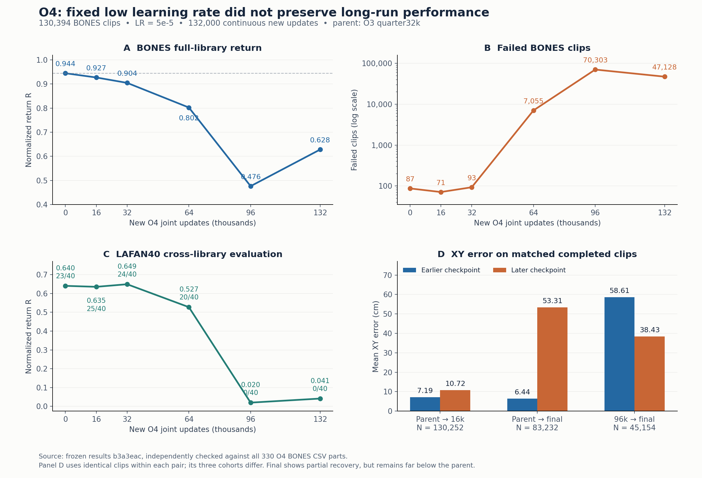

# O4完成复核：低LR未解决长段退化，下一步隔离优化器差异

审阅日期：2026-11-15。结果冻结于[kaiwen123-yang/Supermimic@b3a3eac](https://github.com/kaiwen123-yang/Supermimic/tree/b3a3eac724fa4bc4dd8781dc7c8fb371e95efef8)，campaign `20261113-o4-official-bones-long-s0`。当前官方核心仍为`abc124c1bd5976341034668af3d12c087f2f1f55`，作者研究环境为`dd51a9fcc98791a2f0b018b3c7f71a3eefd5ecdd`。

## 1. 结论与现在该做什么

**O4按计划完整跑完132000新联合更新，但固定5e-5没有保持住长期性能。质量从前16k已经下降，32k后才逐步转为大规模动作失败。** O3的低LR短段收益仍成立；O4否定的是“只固定这个LR继续长训就足以解决退化”。最终节点不适合作为默认续训起点。

最少失败节点是O4+16k的71失败，但它的R低于父节点，flip也从42/44退到31/44。应并列保护O3 quarter16k（质量）、O3 quarter32k（共同父/flip）与O4+16k（总覆盖），同时保留O4后期节点用于解释退化。96k到final确有部分恢复，仍远未回到父水平。

下一步为[O5同父优化器短对照](O5_OFFICIAL_OPTIMIZER_PLAN.md)：两路各32000新更新，固定5e-5，一路保留Muon仅去weight decay，另一路全部Adam且无weight decay。复用O4同预算历史成绩，补完整optimizer配置与少量参数范数；本次不自动长训、调采样或混入其他算法变量。

本次仅做结果与源码审阅、发布计划，没有启动D57任务或修改服务器训练环境。O1/P6已经达成的LAFAN指标结论继续保留。

## 2. 运行完成是真的，低LR也确实生效

O4在2026-11-13 12:03开始，实际训练至2026-11-14 00:17（北京时间），训练时间44055.489秒，即约12小时14分15秒；01:34完成全部轻量发布。实际330006 collection、1351704576新真实transitions、132000 Actor/joint updates、1320000 WM minibatch updates、2640000 Critic minibatch updates。结束原因`new_joint_update_limit`，没有小时deadline或自动重启拼接。

逐项比较O3 quarter与O4 actual config：env_cfg完全一致，runner_cfg仅run_name不同；源commit、Python、import路径和optimizer初始元数据一致。WM/Actor/Critic在构造之前设置5e-5，所有保存节点的Adam device LR和Muon float LR都匹配。没有发现本轮额外更改奖励、终止、DR、sampler或batch的证据。

这是从O3父权重与normalizer开始的新连续训练段。optimizer/replay/sampler/RNG并未恢复，`full_resume=false`正确；祖先加本段得到的195924更新只能作沿革，不能称一个连续195924更新的优化过程。

来源：[summary](../results/20261113-o4-official-bones-long-s0/summary.json)、[实际配置](../results/20261113-o4-official-bones-long-s0/arms/low_lr/actual_config.json)、[训练终点](../results/20261113-o4-official-bones-long-s0/arms/low_lr/training_endpoint.json)、[训练诊断复核](../results/20261113-o4-official-bones-long-s0/training_diagnostics_review_20261115.json)。

## 3. 所有正式节点，不挑最好的一次

| 节点 | BONES R | 完整 / 130394 | 失败 | LAFAN R | LAFAN完整 / 40 |
|---|---:|---:|---:|---:|---:|
| O3 quarter16k（质量锚） | 0.94757578 | 130,300 | 94 | 0.63926816 | 24 |
| O3 quarter32k（O4父节点） | 0.94430475 | 130,307 | 87 | 0.64036472 | 23 |
| O4 +16k | 0.92672114 | 130,323 | 71 | 0.63524271 | 25 |
| O4 +32k | 0.90437763 | 130,301 | 93 | 0.64895802 | 24 |
| O4 +64k | 0.80227512 | 123,339 | 7,055 | 0.52724380 | 20 |
| O4 +96k | 0.47643112 | 60,091 | 70,303 | 0.01995162 | 0 |
| O4 +132k / final | 0.62798132 | 83,266 | 47,128 | 0.04148550 | 0 |

这里的LAFAN是BONES-only模型的跨库评分。O4不继承O1，因此后期0/40不意味着原O1已保存的达标模型被覆盖。五个节点的六条起身均失败，不将其包装成已经获得全部跨库能力。

从+32k到+64k，失败93→7055；到+96k增至70303。final回到47128失败、R=.62798132，属于严重退化后的部分恢复。它与父节点相比只新完成34条，却丢失47075条原完整动作。

来源：[完整逐动作派生审阅](../results/20261113-o4-official-bones-long-s0/review_per_clip_20261115.json)及原各milestone评分。

## 4. 先丢精度、后丢覆盖：共同完成集合的证据

| 同一动作集合上的配对 | 共同完整数 | 前后R | 前后XY误差 | 全库R下降比例 |
|---|---:|---:|---:|---:|
| 父→O4 +16k | 130,252 | 0.944842→0.927201 | 7.19→10.72 cm | 78.67% |
| 父→O4 +32k | 130,227 | 0.944923→0.905010 | 7.18→16.19 cm | 84.96% |
| 父→O4 +64k | 123,275 | 0.944559→0.821574 | 7.20→42.54 cm | 95.04% |
| 父→O4 +96k | 60,049 | 0.943762→0.677044 | 6.49→66.22 cm | 99.72% |
| 父→O4 +132k | 83,232 | 0.947333→0.758929 | 6.44→53.31 cm | 99.24% |

父→+16k共同完整130252条，XY从7.19cm升至10.72cm，R从.944842降至.927201；全库102581/130394即78.67%的动作R下降。+32k同集XY进一步到16.19cm。退化不是仅由几条新增失败拉低均值。

最终与父共同完整的83232条，即便没有触发失败，R仍从.947333下降到.758929，XY从6.44cm增到53.31cm。全库129407条，即99.24%的动作R低于父节点。

另一方面，96k和final共同完整的45154条R从.687185升至.781951，XY从58.61cm降至38.43cm，证明确有恢复。不能因为全库执行前缀XY在final略高于96k，就否定同一集合中的改善：失败截尾与幸存集合发生了变化。表中每行是各自的配对集合，不能把不同行的父均值当成父策略随时间变化。

早期父→+16k共同完整集的R损失，来自root position、body orientation、速度项以及更强的joint-limit/action-rate惩罚等多个分量。低失败数没有保证完整动作跟踪的质量。

## 5. 困难动作、长动作和旧失败集合揭示的取舍

| 节点 | hard639完整 | flip / 44 | side roll / 22 | cartwheel / 120 | handstand / 160 | ≥60秒 / 494 |
|---|---:|---:|---:|---:|---:|---:|
| O3 quarter16k（质量锚） | 594 | 38 | 21 | 118 | 144 | 494 |
| O3 quarter32k（O4父节点） | 597 | 42 | 21 | 114 | 148 | 494 |
| O4 +16k | 601 | 31 | 19 | 118 | 155 | 494 |
| O4 +32k | 581 | 39 | 16 | 118 | 121 | 494 |
| O4 +64k | 601 | 33 | 14 | 118 | 157 | 307 |
| O4 +96k | 358 | 13 | 9 | 46 | 140 | 2 |
| O4 +132k / final | 225 | 11 | 5 | 32 | 12 | 4 |

O4+16k覆盖提高，但flip和side roll低于父；+64k的hard639仍完成601条、handstand157/160，此时非hard已经失败7017条。仅追困难动作或盯hard完成数，会漏掉更大的普通动作退化。

旧失败组也有同样问题：+32k已恢复父87失败中的74条、O2原179失败中的167条，整体R却降到.904378。因此这些集合只能辅助解释，不能成为训练或成功判断的替代目标。

>=60秒的494条在父与早期节点全部完整，64k剩307，96k剩2，final剩4。final在参考时长0–2s、2–5s、5–10s、10–20s、20–60s、>=60s分组中分别失败71/1591、10997/49538、22232/57353、10668/18309、2670/3109、490/494。这里是参考动作时长，不是失败发生时刻。

最终所有20个类别均有失败，包括普通Basic Locomotion Neutral9229条、Baseline7745条、Object Manipulation4657条、Dancing4564条、Gestures4487条。问题已经超出少数高难技能。

## 6. 训练日志支持什么、不支持什么

读取全部166个统计分片，33002采集窗口覆盖1351704576新transitions，窗口计数零缺口；33001个窗口含loss/imagination快照。下表中真实reward是窗口总量之比，loss/gradient/value-tail是日志末次joint快照的统计，不是所有optimizer step的均值。

| 新增更新区间 | 真实采集reward/.1 | WM loss中位数 | Critic loss中位数 | Actor裁剪前梯度中位数 | raw bootstrap>10比例 |
|---|---:|---:|---:|---:|---:|
| 0–16k | 0.84853 | 0.006695 | 0.006288 | 1.250 | 0.892% |
| 16–32k | 0.84832 | 0.006300 | 0.005887 | 1.308 | 2.609% |
| 32–64k | 0.82609 | 0.007470 | 0.006408 | 1.462 | 5.216% |
| 64–96k | 0.78808 | 0.007057 | 0.005175 | 1.661 | 6.625% |
| 96–132k | 0.81805 | 0.006918 | 0.004379 | 2.031 | 8.807% |

Critic loss后期下降，记录的loss全部有限；raw bootstrap最大约10.884，raw GAE最大约10.820，不能称无界数值爆炸。raw>10比例上升值得关注，但实际bootstrap与GAE目标仍沿官方上限裁剪，这个线索还不能定位根因。

最大Actor梯度记录230.528出现在新增70174更新；这是norm=1及element=.1裁剪之前的范数，不是施加到参数上的更新量。现有日志没有WM/Critic梯度范数、实际更新范数或参数范数。

实际训练episode上限10秒，reset会按回报自适应选择动作/相位；正式评估从每条动作开头执行完整时长。训练transition加权reward与全库clip等权R不是同一指标。后期hard termination每百万transitions从16–32k的1610.66降至96–132k的77.70，正式成绩却变坏；训练“摔倒更少”无法证明完整动作更好。hard639 reset share在五段为37.27%、46.40%、41.50%、39.41%、31.21%；handstand reset share升到14.44%后为12.46%。这些是reset份额，不是transition份额或成功率。

normalizer有效count从654630912到2006335488，恰好等于父count加新transitions，未见溢出。Actor obs std最大值3.6265→5.3000，而最小值约.104、median约.89–.95，没有整体尺度坍缩的证据。聚合摘要仍不足以排除个别维度漂移，但不能据此宣布normalizer错误或直接冻结。

来源：[训练区间及全部diagnostics派生数据](../results/20261113-o4-official-bones-long-s0/training_diagnostics_review_20261115.json)。

## 7. 更具体的新线索：Muon权重衰减与论文优化器配方不同

当前[官方工厂](https://github.com/HybridRobotics/supermimic/blob/abc124c1bd5976341034668af3d12c087f2f1f55/src/supermimic/learners/learner_utils.py)对内部Linear权重使用Muon，对其他参数使用Adam。[引入Muon的提交](https://github.com/HybridRobotics/supermimic/commit/0e5ff6bb00166fdbdb308ce23583f55948504fac)明确采用momentum=.95、Nesterov、decoupled weight_decay=.1与五次Newton–Schulz；其报告的是MaxCoord/god-mode/LAFAN40短期奖励学习速度，不是当前GenCoord/proprio/BONES长训练的稳定性保证。

[PyTorch v2.14.0实现](https://github.com/pytorch/pytorch/blob/v2.14.0/torch/optim/_muon.py)确认先以基础LR衰减权重，再以形状调整后的LR施加Muon更新。三个模块每joint的optimizer步数为Actor1、WM10、Critic20。单独抽出衰减项，其乘法系数为：

`(1 - 5e-5 * .1) ** (联合更新数 * 每次联合更新的optimizer步数)`

到32000联合更新，该项的Actor/WM/Critic系数分别约.8521/.2019/.04076；到132000分别约.5169/.001360/.000001851。**这是忽略梯度贡献后单独分解的衰减系数，不是实测权重范数，不代表模型被衰减成零。** 原O4日志没有保存参数范数，也没有展开optimizer group的weight_decay；checkpoint没有optimizer状态。结论目前来自冻结源码、官方提交说明与对应PyTorch版本，应在O5正常构造时补实际参数日志。

论文Table A.5明确写Adam，Actor betas=(.9,.95)，单卡LR2e-4，cosine在250000 iterations到.03倍、总320000 iterations。表格没有单独写weight decay=0；零值对应官方原Adam实现和PyTorch默认。现在不能将当前main的Muon+Adam固定LR称为已完整复制论文历史优化配方。

这也修正了对O3的机制解释：减小LR同时减轻了梯度更新和Muon衰减，O3只能证明该较低LR整套配置短期更好，不能单独证明问题只在步长过大。接下来用A去衰减、B全Adam的同起点对照，才能增加解释力。此处没有证据把默认Muon称为作者bug，也没有证据认定它就是唯一根因。

源码事实与假设边界详见[优化器来源审阅](../results/20261113-o4-official-bones-long-s0/optimizer_source_audit_20261115.json)。

## 8. 评分可信度与失败窗口的边界

本轮独立读取O4全部330个BONES CSV（651970行）、五个LAFAN CSV（200行），另读O3 quarter16k/32k的132个CSV（260788行）。七个BONES节点各有130394唯一原ID，名称/类别/包名/参考帧数一致；逐行R、N−1分母、completion和完整标记一致，没有重复、越界或非有限数。重算R最大差1.30e-14，分组R最大差1.38e-14，完成与transition数完全一致，未发现足以解释退化的评分汇总错误。

final的47128失败由43104个anchor_pos、3533个anchor_ori及491个同时触发构成。actual config中anchor_pos调用`bad_anchor_pos_z_only`，阈值.25m；不能把它误写为平面位置超限。

读取了八个既有NPZ失败尾窗，均为32动作/33状态、帧连续、数值有限。普通idle和cartwheel等也出现实体位置/姿态偏差扩大，支持失败确实发生。窗口重新计算的是pelvis-root原始state，正式quality是anchor body，二者不能直接混用作阈值验证。窗口没有WM预测或反事实干预，无法单独裁决是模型误差、优化器、Critic还是采样导致。没有新增仿真或模型恢复试跑。

来源：[失败窗口标量审阅](../results/20261113-o4-official-bones-long-s0/failure_windows_review_20261115.json)、原final failure_windows及actual config。

## 9. 当前成绩与论文参照的正确关系

已达标的LAFAN结论保留：官方O1 final R=.87443989，旧独立实现P6 B33000 R=.86624655，均超过用户已确认的.82参照。O4后期回撤不撤销已保存的结果。

BONES最好的综合回报仍是O3 quarter16k .94757578，最低总失败是O4+16k的71。论文Figure3的.90线是SONIC参照，不是作者最终回报的精确值；71也没有达到作者单卡实验报道的25失败。更重要的是本项目130394与论文129514的精确成员尚未对齐，不能只凭差880条就称前者是后者超集，也不能据71与25计算复现完成百分比。作者两H100的0失败/9.8h与本机共享Blackwell、继承权重续训的成本不能直接等同。

## 10. 下一步与交付状态

采用[O5完整计划](O5_OFFICIAL_OPTIMIZER_PLAN.md)、[机器协议](../configs/o5_official_optimizer_protocol.json)与[启动提示词](O5_CODEX_START_PROMPT.md)。共同父为O3 quarter32k，两个分支分别只去Muon衰减与使用全Adam，三网络LR仍5e-5，各32000新更新，8/16/32k正式节点。尽可能两路并行，所有真实训练退出后串行全库评分，复用历史父/O4成绩，不增加第三路。

本轮专门回答早期精度是否改善；同一完成集合的R/XY/姿态、父成功保持与全库R共同判断。32k改善不代表132k稳定，也不等于完整论文Adam+cosine从零复现。历史O4参照与新分支并非严格同随机轨迹的同步对照。后续长程方案由这次结果决定，不自动扩展，不机械再降LR。

已发布材料将包括完整派生审阅数据、曲线、计划、协议、启动词及项目状态。大权重不迁移，不自动清理；P12暂停，历史成果保留。本次发布不代表O5已经部署或训练。
