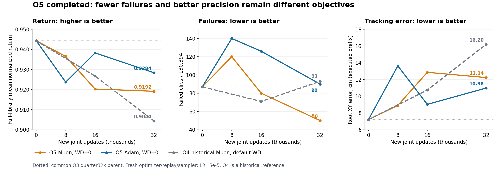

# O5 完成复核：困难动作覆盖提高，父模型精度仍未保持

日期：2026-11-16。结果冻结于 `kaiwen123-yang/Supermimic@cf6f871284f503c8421180c23ccca3f1a7550dac`，campaign `20261115-o5-official-optimizer-s0`。官方 `abc124c1bd5976341034668af3d12c087f2f1f55`、研究库 `dd51a9fcc98791a2f0b018b3c7f71a3eefd5ecdd`。

## 1. 决策先说清楚

**O5 带来了真实的困难动作覆盖进展：Muon WD0 终点只剩 50 条失败，flip 44/44、cartwheel 120/120、handstand 159/160。它应作为新的覆盖参照保留。** 但同一模型的全库回报 .91915658、XY 12.24 cm，均未保住 O3 共同父模型的 .94430475、7.20 cm。

Adam WD0 的终点回报 .92838634、XY 10.98 cm，比 Muon 终点更好，但有 90 条失败，且自己的 +16k→+32k 仍回撤。两臂在覆盖、跟踪精度和原成功集合保持上没有全面赢家；不能选“50 失败”后直接声称长段退化已经解决。

新上传的实际参数范数否定了“旧模型的权重近乎被衰减为零”这一解释。O5 的 WD0、betas、参数覆盖、训练计数及 normalizer 累计设置均符合计划，未发现本轮优化器适配引入的确定性错误。WD0 两臂呈现了不同的参数尺度和覆盖/精度结果，但仍未恢复父点精度；这不足以把既往退化全部归因于 weight decay。

**下一阶段 O6：一条从零 seed0、全 Adam＋cosine 的官方代码有限配方。** 初始 LR2e-4，按公开 runner 的采集循环口径经250k降到0.03倍，320k采集循环结束，预计127,997 joint；四个完整评分节点。它是基于论文配方的实现选择，不是声称找回了作者完整原始 run，也不是隔离 cosine 独立作用的双臂实验。见[具体计划](O6_OFFICIAL_ADAM_COSINE_PLAN.md)、[协议](../configs/o6_official_adam_cosine_protocol.json)和[启动提示词](O6_CODEX_START_PROMPT.md)。**当前仅发布复核与计划，没有部署或启动 D57 O6。**

## 2. 本轮实际完成与复核范围

两臂均从 O3 quarter32k 恢复同一 WM/Actor/Critic 与完整 normalizer，optimizer/replay/sampler/RNG 新建，`full_resume=false`。固定三网络LR5e-5、4096环境、GenCoord/proprio/history10，数据、环境和其余算法配置一致。

每臂实际完成 32,000 新 joint、80,006 次采集、327,704,576 次真实 transition，WM/Actor/Critic 分别320,000/32,000/640,000个优化步骤。单臂训练时长约5小时57分；两个训练子进程均exit0。全部六个BONES节点、六个LAFAN节点和轻量发布均完成。checkpoint metadata 中的 running、training endpoint 中 evaluation_pending 是保存时的历史快照，不能覆盖 campaign 的 completed 状态。

复核读取了：O5 396份BONES CSV共782,364行；同一父点与O4 +16k/+32k额外198份历史CSV，总计1,173,546行；9份LAFAN40逐动作表；全部82份训练日志分片（79,477,219字节、16,004条日志记录）；两份实际配置、normalizer/参数范数快照、6个历史checkpoint范数摘要及源码。九个BONES节点的source_id均为0–130393、没有重复/缺失，参考身份一致；N−1分母、执行边界、完整/失败标志与评分公式核对一致。

这次只读取和计算已上传证据，没有启动模型/物理回放。逐动作配对、全部训练日志统计、读取范围与源路径见[复核数据](../results/20261115-o5-official-optimizer-s0/review_20261116.json)。源码与论文差异见本文第10节。原始[summary](../results/20261115-o5-official-optimizer-s0/summary.json)不改写。

完整仓库树有11,524个条目、10,813个文件、3,249,496,134字节；本次取齐其中261个当前非results文本文件，并以源码调用链和阶段记录确定需深读的原件。上列594份逐动作分片与82份日志已实际解析，未用结果索引代替原件。本次不声称已经逐字节审阅其他全部历史分片、服务器未上传的checkpoint和完整轨迹。

## 3. 全部正式节点

R为每clip原生reward总和除以`.1*(N−1)`、失败尾段为零后再取clip宏平均。下表XY是各clip已执行前缀误差的宏平均，失败前缀长短不同；公平精度比较另看共同完整集合。body orientation为相对身体姿态误差，单位rad。LAFAN是BONES-only训练后的跨库评分，不是O1遗忘，也未证明严格未见泛化。

| 节点 | BONES R | 完整 / 130,394 | 失败 | XY cm | body ori rad | LAFAN R / 完整40 |
|---|---:|---:|---:|---:|---:|---:|
| 共同父 O3 quarter32k | 0.94430475 | 130,307 | 87 | 7.204 | 0.100338 | 0.640365 / 23 |
| 历史 O4 +16k | 0.92672114 | 130,323 | 71 | 10.739 | 0.113348 | 0.635243 / 25 |
| 历史 O4 +32k | 0.90437763 | 130,301 | 93 | 16.203 | 0.131654 | 0.648958 / 24 |
| Muon WD0 +8k | 0.93653324 | 130,274 | 120 | 8.911 | 0.109527 | 0.652430 / 27 |
| Muon WD0 +16k | 0.92026524 | 130,314 | 80 | 12.861 | 0.118590 | 0.665360 / 29 |
| Muon WD0 +32k | 0.91915658 | 130,344 | 50 | 12.236 | 0.122653 | 0.658787 / 26 |
| Adam WD0 +8k | 0.92371814 | 130,254 | 140 | 13.630 | 0.117723 | 0.620553 / 25 |
| Adam WD0 +16k | 0.93826439 | 130,268 | 126 | 9.029 | 0.105760 | 0.631635 / 25 |
| Adam WD0 +32k | 0.92838634 | 130,304 | 90 | 10.981 | 0.117642 | 0.632822 / 24 |

两条O5终点均优于相同新增32k的历史O4：Muon R提高.01477895、Adam提高.02400871，XY也更低。但是O4是历史同父参照，不是本轮同步随机轨迹对照；改善不能外推到132k或跨seed稳定。

O3 quarter16k的R=.94757578仍是已有质量参照；O3 quarter32k仍是本轮共同父参照。O5不替换这些历史节点。O1/P6的LAFAN成功也继续保留。

## 4. 覆盖改善具体来自哪里

| 固定集合 | 父 O3 quarter32k | Muon WD0 +32k | Adam WD0 +32k |
|---|---:|---:|---:|
| 固定 hard | 597/639 | 623/639 | 596/639 |
| non-hard | 129,710/129,755 | 129,721/129,755 | 129,708/129,755 |
| 翻腾 flip | 42/44 | 44/44 | 38/44 |
| 侧滚 side-roll | 21/22 | 21/22 | 18/22 |
| 侧手翻 cartwheel | 114/120 | 120/120 | 117/120 |
| 倒立 handstand | 148/160 | 159/160 | 154/160 |
| ≥60 秒长动作 | 494/494 | 494/494 | 494/494 |

Muon的50失败由**hard16＋non-hard34**组成；Adam的90失败由**hard43＋non-hard47**组成。不能把剩余失败统称为“只剩最难特技”。两臂共同失败11条，Muon独有失败39条，Adam独有失败79条；这说明它们掌握的成功集合不完全嵌套，不能合并不同checkpoint的逐动作最好结果当一个策略。

对父模型87条失败，Muon恢复80条，残留7条，但父原成功动作中又失去43条，所以最终`7+43=50`。Adam恢复56条、残留31条、新失59条，所以`31+59=90`。相对父净增37个完整动作与净少3个完整动作，是上述恢复/新失共同作用的结果。

从Adam自身16k到32k，失败数从126降到90，恢复84条、又丢48条；覆盖上升同时精度下降。由此可见“失败数更低”不能替代对同一批完整动作的质量判断。

困难技能的质量也有分化：Muon与父点共同完成的cartwheel动作，R从.766219提高到.791209；handstand从.529893提高到.606285。相同42条flip的R却从.745933降到.719778，XY从25.01cm增至48.11cm。因此44/44说明flip的执行覆盖提高，不能单独推出flip跟踪质量提高。

## 5. 精度回退不只是少数失败动作造成的

下面每一行都只比较两节点**共同完整执行**的相同动作，避免失败尾段/存活长度差异。

| 配对 | 共同完整数 | R 前→后 | XY cm 前→后 | body ori rad 前→后 |
|---|---:|---:|---:|---:|
| 共同父 O3 quarter32k → Muon WD0 +32k | 130,264 | 0.944802 → 0.919518 | 7.192 → 12.226 | 0.100029 → 0.122408 |
| 共同父 O3 quarter32k → Adam WD0 +32k | 130,248 | 0.944857 → 0.928904 | 7.184 → 10.966 | 0.099964 → 0.117327 |
| Adam WD0 +16k → Adam WD0 +32k | 130,220 | 0.938954 → 0.928939 | 9.015 → 10.964 | 0.105433 → 0.117337 |
| Muon WD0 +32k → Adam WD0 +32k | 130,265 | 0.919505 → 0.928848 | 12.225 → 10.972 | 0.122447 → 0.117416 |

相对父点，Muon共同完整130,264条中，**103,034条（79.10%）回报下降、84.01%身体姿态误差增加**；Adam共同完整130,248条中，**112,067条（86.04%）回报下降、87.17%身体姿态误差增加**。因此不是仅50/90条失败拖低平均数，而是广泛的精度回退。

Adam16k→32k在共同完整130,220条中，78.37%回报下降；与此同时它的训练reward和WM/Critic loss却改善。训练期采用自适应随机相位reset和10秒episode上限，正式评分则从整条动作开始运行；两者分布和分母不同，不能用训练loss替代全库判断。

两臂最终共同完整130,265条上，Adam平均R比Muon高.00934273、XY低1.254cm、身体姿态误差低.005030rad；但只有56.02%的动作R更好、49.66%的动作XY更小，不能说Adam对每条动作都更准。

长动作尤其说明“完成”与“贴近参考”不同：≥60秒的494条在父、Muon32k、Adam32k都全部完成，但XY均值分别为**25.66cm、78.00cm、56.52cm**，R为.930420、.874202、.890375。官方硬终止与连续跟踪奖励本来就衡量不同属性，报告二者不会改变成功口径。

共同完成集合的奖励分解中，root-position和body-orientation两项合计解释Muon约65.7%、Adam约82.9%的回报下降，其他奖励贡献也下降。这是已观察回报差的数学分解，不是训练机制的因果证明。

完整统计还保留各技能、类别、时长、固定旧失败集合、17组两两配对和固定多节点共同完成集；不得仅挑有利子集作结论。16k、32k的四方共同完整集合恰好同为130,148条，但成员不同；九个节点共同完成的固定129,991条上仍呈现相同回退趋势，避免把“数量相等”误当“同一集合”。

### 5.1 只补齐剩余失败尾部，远远不够

令C为逐clip执行比例的宏平均，有 `1-R=(1-C)+(C-R)`。Muon终点C=.999790837，未执行尾部1-C=.000209163，而已执行片段质量损失C-R=.080634258；Adam终点对应.999655249、.000344751、.071268911。未执行尾部分别只占相对理论满分差距的0.259%和0.481%。

因此，99%以上的满分差距发生在已执行片段。保持已执行片段原有质量、仅把剩余尾部补成满分，只能增加约.00021/.00034，无法弥补相对父点约.025/.016的下降。这是条件计算，不是未来策略性能上界，也不等于99%的损失都来自普通动作。

两个O5终点共同失败11条，再与父点取交集仅2条；Muon最终50条失败里有48条曾被父点或Adam终点完整执行。剩余失败不能全部解释为永久不可行数据，但曾完整执行也不能替代作者的可行性筛选或证明精确动态可行。

为下一轮保留4个事先指定的诊断动作：63672（普通jog，Muon改善而Adam回撤）、101155与124371（两条长Idle动作）、16（稳定stretch）。三模型均完整执行；101155的父/Muon/Adam平均XY为.1235/4.3082/.2177m，124371为.0655/.1549/1.1870m。它们用于观察同一动作怎样变化，不是代表全库的随机抽样，也不另行重跑旧checkpoint。

## 6. 参数范数的新证据：修正衰减假说

下表为实际checkpoint中结构性隐藏Linear权重组的pooled RMS，除以共同父点的同组RMS。Actor只列活跃motion+decoder，排除本轮未使用、始终不变的velocity分支。它不是“只执行衰减项”所得的理论乘子。

| 节点 | WM隐藏矩阵 | Actor活跃隐藏矩阵 | Critic隐藏矩阵 |
|---|---:|---:|---:|
| O4 +32k | 0.9580× | 0.9266× | 0.9117× |
| O4 +132k | 0.9609× | 0.8025× | 0.7734× |
| O5 Muon WD0 +32k | 2.0645× | 1.0726× | 2.8432× |
| O5 Adam WD0 +32k | 1.8493× | 1.0378× | 3.7067× |

O4长段后期的实际隐藏矩阵缩小程度远小于理论decay-only乘子，WM甚至一直接近父值。全网络pooled RMS在O4+132k为WM1.1001×、Actor.9962×、Critic1.1786×，因此不能说整个网络被衰减没了。之前用于提出假设的理论乘子必须与本次实测区分。

去decay后确实改变了隐藏层尺度，却仍没有恢复父点精度。另一方面，O5 Critic的2.843/3.707×只对应一块128×256隐藏矩阵；**全Critic参数**RMS仅1.0503/1.0445×。两臂已记录raw bootstrap最大值约10.193/10.136，实际clamp后不超过10；这不支持“critic权重变大就发生无界value爆炸”的解释。

范数只描述参数大小，不是参数相对初始的位移、实际更新量或预测质量；本次数据不能单独确定哪一环造成精度回退。

## 7. 训练执行有没有明显接错

两臂各8,002个日志窗口恰好覆盖全部新增transition，8,001份非空最后joint快照；reset数与episode数差都等于初始4096环境。四个active normalizer的count从654,630,912连续累积到982,335,488，等于父计数加新增transition，没有计数重置；未启用velocity normalizer保持0符合配置。

实际optimizer metadata覆盖initial/8k/16k/32k/final：Muon臂仅官方内部Linear用Muon，其余Adam；Adam臂全部Adam；WD都为0，Actor betas(.9,.95)、WM/Critic(.9,.999)，LR5e-5。WM14个参数张量、Actor54、Critic10覆盖恰好一次，没有遗漏或重复。O4/O5环境与数据配置相同，runner差别为run_name和预期optimizer_mode字段。

16–32k区间的真实采集奖励/.1，Muon为.82070、Adam为.85473；WM loss中位数分别.007292/.007107。Muon后半段采样到handstand的reset占比提高至7.34%，Adam为1.81%；这是被抽中参考clip的比例，不能当作技能transition配额或成功率。

全82份原始日志独立统计显示：Adam前/后半段采集归一化回报为.841058→.854726，WM loss中位数.00984067→.00710733，Critic loss中位数.00739889→.00539863，但正式16k→32k回报由.938264降至.928386。区间按日志末次joint计数分组；loss是窗口末次更新快照，采集回报是窗口转移总量，不混为同一种平均。

bootstrap贡献约73%本身也不是异常：gamma=.99、H=32时，稳定无限回报的折扣尾部比例gamma^32约72.50%。需要实际误差校准才能归因critic，不能由占比大就推断失效。

Actor日志记录的是裁剪前gradient norm，有147/306等尖峰；源码随后按总norm1和元素.1裁剪，不能把日志尖峰当实际参数更新量。已记录标量有限，但没有每一步WM/Critic梯度和实际步长，不能宣称所有未记录计算均稳定。normalizer的分位数范围也未整体坍塌，但其逐维功能影响并未被隔离。

同次正式评分实际上传14个失败尾窗（Muon6、Adam8）已全部读取，数值有限，k步动作/奖励对应k+1个状态。Adam最早失败样本只有14步，其余为32步。这些按分组保留较小source ID的窗口不构成随机代表性抽样，不能替代全量失败分布。两臂anchor body均为pelvis；`anchor_pos`是z误差>.25m，`anchor_ori`是投影重力z分量差>.8，并非XY或四元数角阈值。保存的post-step状态/已前移参考与原生判定时点不同，不用最后一帧raw误差机械重判。原件见该campaign两个终点的 `bones_full/failure_windows` 与各自schema。仓库完整文件树没有MP4/WebM/GIF，因此本次依据数值和短轨迹审阅，没有声称观看O5视频。

## 8. 为什么转向 O6，具体改什么

O2/O4已经显示固定LR长段可能回退，O5又说明去decay/all-Adam的同父短段不能自动保住精度。更有价值的下一步是跑通一条尚未完成的论文训练路径：**从零、三网络Adam、初始2e-4、cosine到.03倍并观察最后低LR保持段。** 这使目标重新集中在官方代码复现，而不是不断从相同父模型开启新小消融。

论文Table A.5公开250k衰减/320k训练，但没有给出可绑定原成绩的scheduler/run artifact。当前以及Muon前公开runner的`max_iterations`是外层采集循环。O6据此明确选择320k collection，约127,997 joint；不会把320k误当joint而扩大2.5倍预算。LR必须通过CUDA capture前创建的Adam设备标量、运行中原位更新来生效。

四个正式节点为collection80k/160k/250k/320k，预期joint31,997/63,997/99,997/127,997，LR约1.55e-4/6.17e-5/6e-6/6e-6。最后70k采集、约28k联合更新用于观察低LR保持。无小时截止，tmux连续跨交互窗口；只开一条有明确目的的训练臂。

O6继续当前GenCoord、官方horizon8（8个存储状态/7个受监督转移）及既有encoder-bias语义，不同时改表示、normalizer、奖励、采样或网络。GenCoord/MaxCoord主成绩归属、当前代码后续架构改动、130,394对129,514动作成员以及精确论文时钟仍有证据边界。详见本文第10节的源码与论文对应关系。它们应被明确记录，不能被假装成“已经逐项一致”，也不因缺少原run而停下已能执行的复现工作。

若O6效果更好，能支持这条具体配方在本seed/环境/有限预算上的效果；不能据此证明cosine是唯一根因或跨seed稳定。若仍回退，按四节点与训练证据继续定位，不自动加预算、增seed或开启O7。作者的129,514条单H100/3小时25失败、双H1009.8小时0失败是不同数据/硬件条件的参考，本项目50失败不能直接换算复现完成百分比；SONIC .90也不是作者本人完整终点回报。

## 9. 交付与保护

本次同步复核、派生统计、O6方案/协议/启动词与仓库入口。原始O5 summary、逐clip分数与实际训练产物不修改。O6标记为planned_not_started，D57没有因本次文档发布而开始训练。

O3 quarter16k质量锚、quarter32k共同父、O4全部节点、O5全部节点（尤其Muon32k覆盖锚、Adam16k/32k）、O2/O1/P6和其他历史保护成果全部保留。大checkpoint、日志和完整轨迹留服务器待用户管理；不自动归档/清理。P12暂停，既有LAFAN验收不变。

主要依据：[冻结O5结果](https://github.com/kaiwen123-yang/Supermimic/tree/cf6f871284f503c8421180c23ccca3f1a7550dac/results/20261115-o5-official-optimizer-s0)、[实际优化器补丁](https://github.com/kaiwen123-yang/Supermimic/blob/cf6f871284f503c8421180c23ccca3f1a7550dac/scripts/o5/official_optimizer_modes.patch)、[历史真实参数范数](https://github.com/kaiwen123-yang/Supermimic/blob/cf6f871284f503c8421180c23ccca3f1a7550dac/results/20261115-o5-official-optimizer-s0/historical_o4_weight_norms.json)、[论文v2](https://arxiv.org/pdf/2610.28480v2)、[当前runner](https://github.com/HybridRobotics/supermimic/blob/abc124c1bd5976341034668af3d12c087f2f1f55/src/supermimic/runners/supermimic_runner.py)、[Muon前runner](https://github.com/HybridRobotics/supermimic/blob/8edc58222920fd285e12b5ee1a56713fa2c83052/src/supermimic/runners/supermimic_runner.py)。

## 10. 官方开源与论文配方之间，实际还差哪些对应关系

官方 `HybridRobotics/supermimic` 与 `HybridRobotics/mjlab_research` 均已公开；固定源码如文首。官方主库完整树74项、63个文件，其中35个src Python源码文件。README提供GenCoord/MaxCoord训练与回放，Apache-2.0许可。旧研究依赖404已解决，不是当前阻塞。

但最短README训练命令的默认配置只指向LAFAN单动作 `lafan_run1_subject5`，runner默认 `rep_state/history1/max_iterations1000000`。论文Table A.5的三网络Adam、250k余弦到.03倍、总320k并未绑定为README的一条论文完整命令。O1–O5已经显式设置proprio/history10和对应数据，不能把默认值差异误说成当前仍未改正的错误。

| 对应项 | 论文与当前公开源码事实 | 下一步处理 |
|---|---|---|
| 优化器/日程 | 论文全Adam+cosine；当前main中间Linear采用Muon、其余Adam，无cosine；O5全Adam分支仍热启动+固定5e-5 | O6从零完成明确的全Adam+cosine路径 |
| 训练状态 | O5仅继承三网络和normalizer，optimizer/replay/sampler重建 | 不把O2→O3→O5的累计沿革数字当单条连续run |
| iteration | 当前和Muon前runner均把max_iterations用于外层采集；论文未给可绑定原run的scheduler | 明确选collection时钟，320k collection约127997 joint，保留映射未获作者run确认的标注 |
| 数据成员 | 论文142220→名称筛129667→可行性筛129514；本地130394 | CPU并行核对成员、版本与过滤，不能删失败凑数量 |
| 主结果表示 | main同时有GenCoord/MaxCoord；没有绑定主结果的run配置 | 沿用当前GenCoord，不能称已知作者主实验表示 |
| WM窗口 | config horizon8采8个存储状态、监督7个转移；论文Eq1写j=1..8 | 保留当前官方行为并披露，不混入horizon9改动 |
| Actor位置反馈 | motion goal不传相对根XYZ；硬终止只看根高与投影重力z差 | 完整数和XY精度分开报告；不加XYZ后称官方原版 |
| 其他版本语义 | 当前10帧goal stride5、Linear/LayerNorm/GELU、keep分布累计focus²；论文未明确全部细节 | 记录差异，不把文本未说明直接认作实现bug |

静态核对还发现两个活跃训练输入差异：GenCoord合成proprio忽略encoder bias，而真实关节观测包含episode bias；完全padding的reset历史9帧与当前帧可能使用不同噪声，而真实reset历史重复同一读数。相关第三方PR #15、#6仍未合并，影响大小没有正式训练证据。正式评测bias/noise为0，所以它们不是直接污染评分的解释；本轮O6不混入补丁，以免完整配方比较同时改变输入语义。PR #7的autograd泄漏触发前提在当前inference_mode采集路径不成立，PR #9也不能解释独立正式评分的回撤。

O5短窗只含真实仿真状态，没有对应同输入WM预测。因此“世界模型过于乐观”“Actor利用模型误差”“Critic导致崩溃”仍是待验证机制，不能根据训练loss下降或一个失败尾帧就认定。

已检查官方树、README、play入口、Releases以及项目demo公开说明，未找到能够绑定论文主结果的checkpoint、完整训练配置与129514动作名单组合。浏览器demo的36条展示动作及网页模型不提供这个对应关系。它们不能直接替代作者主实验checkpoint在本项目评测器上的对照。若作者后续公开对应bundle，固定作者模型在相同协议下评测会是很有价值的诊断。

主要源码：[训练默认值](https://github.com/HybridRobotics/supermimic/blob/abc124c1bd5976341034668af3d12c087f2f1f55/src/supermimic/scripts/train.py)、[runner配置与循环](https://github.com/HybridRobotics/supermimic/blob/abc124c1bd5976341034668af3d12c087f2f1f55/src/supermimic/runners/supermimic_runner.py)、[优化器/CUDA graph](https://github.com/HybridRobotics/supermimic/blob/abc124c1bd5976341034668af3d12c087f2f1f55/src/supermimic/learners/learner_utils.py)、[状态与观测](https://github.com/HybridRobotics/supermimic/blob/abc124c1bd5976341034668af3d12c087f2f1f55/src/supermimic/representations.py)、[reset sampling](https://github.com/HybridRobotics/supermimic/blob/abc124c1bd5976341034668af3d12c087f2f1f55/src/supermimic/runners/reset_sampling.py)、[PR15](https://github.com/HybridRobotics/supermimic/pull/15)、[PR6](https://github.com/HybridRobotics/supermimic/pull/6)、[作者项目与基准定义](https://supermimic.github.io/)、[论文v2](https://arxiv.org/pdf/2610.28480v2)。
