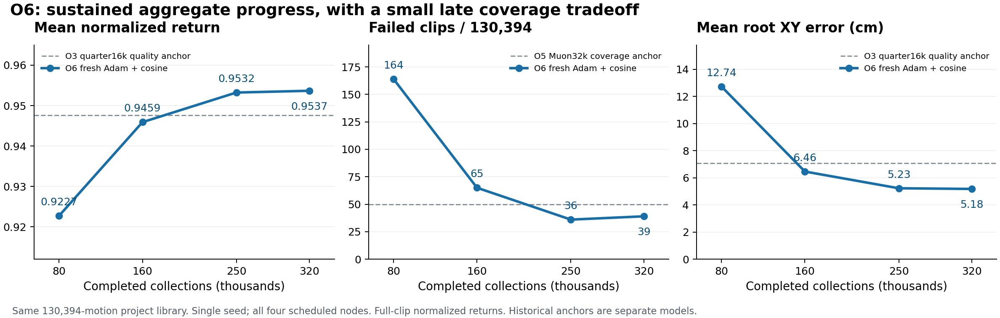

# O6 全量结果复核与下一步判断

日期：2026-11-17（北京时间）。**O6 训练、四个实际节点的正式评分和轻量发布均已完成；本次完成结果复核并准备 O7，尚未部署或启动 O7。**

固定结果版本：[8f23f4b26fc84598dc19429963ddb8cd18cd37ee](https://github.com/kaiwen123-yang/Supermimic/commit/8f23f4b26fc84598dc19429963ddb8cd18cd37ee)。机器可读统计见 [review_20261117.json](../results/20261116-o6-official-adam-cosine-s0/review_20261117.json)，执行事实见 [原始 summary](https://github.com/kaiwen123-yang/Supermimic/blob/8f23f4b26fc84598dc19429963ddb8cd18cd37ee/results/20261116-o6-official-adam-cosine-s0/summary.json)。

## 1. 结论先行

**O6 已经取得明确进展：完整 fresh Adam＋cosine 配方显著改善全库跟踪精度，且没有重现 O4 的全库崩溃或 O5 那样的普遍质量回撤。剩下的主要问题是少数技能的覆盖和保持、部分长动作尾段回撤，以及与作者基准仍未完全对齐。**

O6 终点 R=0.9536654882、130355/130394 条完整、39 条失败、平均根 XY 误差5.180cm。250k 节点有更少的36条失败，但终点全库回报和共同完整集合精度更高。应该同时保留两个节点及其取舍，不用逐动作挑模型拼成更好的虚拟成绩。

最突出的技能缺口是 monkey_jump：18条只完整1条，而 O5 Muon32k 曾完整14条。最终39条失败全部在某个已读历史节点完成过，不能统一解释为不可行动作，也不能仅凭名字将它们删除。

官方刚发布了一个与当前问题直接有关的修正：[7e94b0 删除 collection 动作噪声](https://github.com/HybridRobotics/supermimic/commit/7e94b073940b7a19b9a82ff01e191cfb35c4ba91)。作者报告该修改对其 Muon/history10 实验影响很大，对 Adam 影响较小。**它提供了有源码依据的下一步干预，但还不能证明它是我方所有历史退化或当前39条失败的唯一原因。**

下一步：[O7 完整计划](O7_OFFICIAL_NOISE_REMOVAL_PLAN.md)、[执行提示词](O7_CODEX_START_PROMPT.md)、[机器可读协议](../configs/o7_official_noise_removal_protocol.json)。保留 O6 的全部有效配方，只删除官方额外采样动作噪声，从零、同预算比较；不同时换优化器、重筛数据或加训。

既有 LAFAN 验收继续成立：P6 B33000 R=.86624655 达到用户确认的.82；O1 官方从零3小时节点 R=.85882311，实际终点 R=.87443989、40/40。BONES-only 的跨库评分不撤销这些成绩。来源：[P6结果](../results/20261105-p6-position-feedback-s0/summary.json)、[O1复核](O1_REVIEW_20261111.md)。

## 2. 本次实际读取了什么

这次不是只看 summary 或截图。按 source_clip_id 对齐了以下完整原件，读取全部记录和字段，再对结论作交叉检查：

| 原件范围 | 完整覆盖 |
|---|---:|
| O6 四节点 BONES CSV | 264文件，521576条逐动作评分 |
| O6 四节点 LAFAN CSV | 4文件，160条逐动作评分 |
| 上述 CSV 仓库源字节 | 228010134 |
| O6 training_stats | 161文件，32001条统计记录，125028125源字节 |
| 固定质量时序、失败窗及其元数据 | 16+7个NPZ、22个schema/meta，共45文件、1057566字节 |
| P9 原始名称/物理筛选记录 | 72个JSONL，142220条，65655143源字节 |
| 历史完整参照 | O3 quarter32k、O5 Muon32k、O5 Adam32k各全BONES和LAFAN |
| 相关执行源码 | O6全套适配、继承的O3/O5实现、实际配置、进度/结束/发布记录 |
| 作者来源 | 当前官方源码与旧版本双树差异、研究依赖、论文v2、项目页、公开发布工件情况 |

CSV 经文本接口读取时 CRLF 被规范为 LF，本地文本227488130字节；差522004字节恰为行末CR数量。逐条内容已解析，但不宣称本地文件与仓库逐字节相同。训练统计本地落盘增加了每文件一个结尾换行，因此本地125028286字节也不替代源字节口径。

没有读取本次未上传的大 checkpoint、服务器完整视频或所有历史仓库文件；没有把缺失的作者权重、名单和实验配置说成已核实。这里的“全量”指上述明确范围，而不是无限扩大到不可访问的每个服务器字节。

数据来源：[O6 原始结果目录](https://github.com/kaiwen123-yang/Supermimic/tree/8f23f4b26fc84598dc19429963ddb8cd18cd37ee/results/20261116-o6-official-adam-cosine-s0)、[P9 filter_records](https://github.com/kaiwen123-yang/Supermimic/tree/8f23f4b26fc84598dc19429963ddb8cd18cd37ee/results/20261107-p9-critic-full-scale-s0/bones_data/filter_records)。

## 3. O6 完整成绩：整体改善，尾段出现有限取舍

R是每clip原生reward之和除以0.1×参考转移数，然后逐clip等权平均。失败后未执行尾部为0；完整数与精度分开报告。XY是实际已执行片段的时间均值，再对clip等权；严格精度变化另在共同完整集合比较，避免失败前缀偏差。

| collection | 实际joint | BONES R | 失败 | 平均XY/cm | 身体姿态/rad | hard639失败 | nonhard失败 | LAFAN R / 完整 |
|---:|---:|---:|---:|---:|---:|---:|---:|---|
| 80000 | 31997 | .922718558 | 164 | 12.738 | .113300215 | 96 | 68 | .590488937 / 22 |
| 160000 | 63997 | .945902665 | 65 | 6.463 | .094659721 | 37 | 28 | .614342243 / 23 |
| 250000 | 99997 | .953232182 | 36 | 5.229 | .086238285 | 25 | 11 | .649366960 / 25 |
| 320000 | 127997 | .953665488 | 39 | 5.180 | .086116307 | 28 | 11 | .655191852 / 26 |



历史质量参照 O3 quarter16k 为 R=.9475757844、94失败、XY7.085cm；O3 quarter32k 为 R=.9443047501、87失败、XY7.204cm。O5 Muon32k 为 R=.9191565790、50失败、XY12.236cm；O5 Adam32k 为 R=.9283863383、90失败、XY10.981cm。O6终点全库指标都明显改善，但它拥有新的初始化、学习率路径和更长连续训练，不能将提升唯一归因于 cosine。

为避免比较的动作集合发生变化，再看各自共同完整集合：

| 历史参照→O6终点 | 修复历史失败 | 丢失历史成功 | 共同完整数 | 共同R旧→新 | 共同XY旧→新/cm |
|---|---:|---:|---:|---|---|
| O3 quarter32k | 73 | 25 | 130282 | .944781122→.953961717 | 7.192→5.164 |
| O5 Muon32k | 46 | 35 | 130309 | .919441051→.953898531 | 12.228→5.171 |
| O5 Adam32k | 73 | 22 | 130282 | .928835273→.953952931 | 10.970→5.165 |

与 O3/O5 Muon/O5 Adam 对应的共同集合中，回报上升的动作分别为102526/111028/119474条，下降27756/19281/10808条。提升不是靠少数失败动作变成成功来抬高整体分数。

原始与派生来源：[四节点结果](../results/20261116-o6-official-adam-cosine-s0/README.md)、[本次逐组/逐身份比较](../results/20261116-o6-official-adam-cosine-s0/review_20261117.json)、[O3复核](O3_REVIEW_20261113.md)、[O5复核](O5_REVIEW_20261116.md)。

### 最后70k collection：总体精度略升，不等于所有能力都在改善

250k→320k，修复11条、丢失14条、持续失败25条，所以36→39。共同完整130344条的 R 从.9534187834升到.9538625267，XY从5.224cm降到5.175cm；70608条回报升、59736条降，中位变化+.000151132。共同集合根姿态误差略增.0381106→.0385828rad，身体姿态略降.0861833→.0860457rad。

hard639 的回报从.780882779降到.777207494，失败25→28。全部≥60秒的494条动作在四节点都完整，尾段 R 从.955565246降到.953795847，XY从13.866cm升到15.140cm，245条回报升、249条降。因为这些长动作始终全部完成，该变化不是失败前缀造成的统计假象。

LAFAN末段保住原来25条并新增id38，共同25条 R .820483941→.822004692，XY1.5992→1.5217m。全40的XY却1.3664→1.4269m，正说明全表均值与同集合精度应区分。该评分是BONES-only跨库表现，不是O1模型遗忘的实验。

因此，O6尾段更接近平台并伴随局部保持问题，证据不支持把它描述成 O4 那样的广泛崩溃，也不支持把继续降学习率或无限延长训练当作已证明的解法。

## 4. 执行是否跑偏：主要嫌疑已排除到什么程度

核对对象是实际执行源码、配置和日志，而不只是计划文本。原始来源：[scripts/o6](https://github.com/kaiwen123-yang/Supermimic/tree/8f23f4b26fc84598dc19429963ddb8cd18cd37ee/scripts/o6)、[actual_config](https://github.com/kaiwen123-yang/Supermimic/blob/8f23f4b26fc84598dc19429963ddb8cd18cd37ee/results/20261116-o6-official-adam-cosine-s0/actual_config.json)、[O6完成交接](O6_EXECUTION_HANDOFF.md)。

| 检查 | 证据与结论 |
|---|---|
| 从零初始化 | seed0、parent=null、无历史checkpoint加载；三网络/normalizer/optimizer/replay/sampler从零，数据来源直接读manifest |
| 优化器 | 三网全Adam、WD0，参数覆盖与实际配置符合O6；不是只修改了配置标签 |
| 学习率生效 | CUDA capture前创建device LR；每collection完成后、learner前原位更新全部group；三网记录一致 |
| LR数值 | 四节点约1.54975205e-4、6.16994075e-5、6.00000021e-6、6.00000021e-6；与公式最大差7.28e-12，为float32量级 |
| 训练量 | 320000 collection、127997 joint、1310720000真实转移；WM/Actor/Critic优化步为1279970/127997/2559940 |
| 归一化 | 四个活跃normalizer计数0→1310720000；未用的velocity normalizer为0符合当前观测路径 |
| 结束与评分 | 正常collection预算退出；四节点全部评分/发布完成；saved_nodes中的pending是保存时历史快照 |
| 日志数值 | 已发布统计未显示广泛非有限loss或普遍价值爆炸；这不是对所有未记录更新的逐步保证 |
| 硬件与时间 | RTX PRO6000 Blackwell Server Edition，非H100；训练39623.227971秒，约11小时0分23秒，不含后续全部评分发布 |
| 当前环境 | 实际PyTorch2.14.0+cu130；不能把官方新lock中的版本当作已运行环境 |

训练约2026-11-16 19:58:57开始、11-17 06:59:25退出，08:06完成发布。共享条件和GPU不同，不能把这11小时直接与作者单H100 3小时或双H100 9.8小时作算法效率等价比较。

普通日志也提示了局部后段问题：160001–250001与250001–320000区间，归一化真实训练奖励均值约.85556→.84402，WM state loss中位数.008423→.010217，Critic loss中位数.006912→.008209，hard reset share约.46766→.48169。这些来自不断变化的采样分布，不能据此单独推出WM恶化导致失败。

bootstrap份额约.73与gamma=.99、H32下的gamma^32≈.725在量级上相符，不是“占比高即公式错误”。raw bootstrap>10与GAE>10的记录比例均极低，也不支持旧式普遍爆值解释。当前主要矛盾不是“没跑满”“LR只改了配置”“全网被weight decay归零”这类已核对的执行偏差。

## 5. 失败集中在哪里：应追技能保持，而不是笼统追加训练

### 5.1 最后的39条并非永远无法执行

其中38条在O3 quarter32k、O5 Muon32k或O5 Adam32k至少一个模型上完整执行过；唯一三历史参照都失败的id7307，在O6 250k已完整。O6自己的前三节点已经完成过终点39中的18条。

严格结论是：**这些动作在当前完整执行判据下具有历史成功先例。** 这不等于证明参考运动每一帧都能被精确物理复现，也不保证所有动作都应属于作者基准。完整名单见附录。

### 5.2 monkey_jump 是最集中的能力缺口

| 名称组 | 总数 | O3 quarter32k完整 | O5 Muon32k完整 | O5 Adam32k完整 | O6 80k/160k/250k/320k完整 |
|---|---:|---:|---:|---:|---|
| monkey_jump | 18 | 11 | 14 | 8 | 0 / 0 / 1 / 1 |
| hook_jump_off_wall | 12 | 10 | 7 | 8 | 3 / 7 / 8 / 9 |
| crutches | 432 | 426 | 428 | 429 | 421 / 429 / 431 / 430 |

最终39失败中的17条为monkey_jump，占43.6%。O6唯一成功monkey是9457，它却在O5 Muon失败，说明两者能力不是简单包含关系。O6整体更好和O5 Muon擅长这类技能可以同时成立。

其他固定技能也有不同轨迹：

| 节点 | flip / 44 | cartwheel / 120 | handstand / 160 | side_roll / 22 |
|---|---:|---:|---:|---:|
| O6 80k | 38 | 119 | 150 | 8 |
| O6 160k | 40 | 120 | 159 | 22 |
| O6 250k | 43 | 119 | 159 | 22 |
| O6 320k | 42 | 120 | 159 | 21 |
| O5 Muon32k | 44 | 120 | 159 | 21 |

不能只看39接近0就认为问题只剩随机噪声；也不能只看monkey差就否定全库精度的明显进展。

### 5.3 固定时序和失败窗的真实含义

四个预先指定诊断样本全部完整执行：

| source_clip_id | O6 80k R / XY(cm) | 160k | 250k | 320k |
|---:|---|---|---|---|
| 16 | .973377 / 6.114 | .978986 / 2.868 | .986855 / 1.886 | .987403 / 2.325 |
| 63672 | .802553 / 14.374 | .883226 / 5.900 | .866709 / 11.976 | .869665 / 9.750 |
| 101155 | .979565 / 5.226 | .987648 / 2.819 | .984053 / 3.374 | .986090 / 3.278 |
| 124371 | .929029 / 31.310 | .995847 / .473 | .994381 / 2.003 | .995157 / 1.982 |

id63672此前O5 Adam R约.344369，O6恢复明显，但本轮160k仍好于终点，不是单调改善。两个76.52秒站立101155/124371的终点XY分别3.267/1.129cm，没有重现旧例的米级漂移；四条固定案例不代表全部494长动作。

7个终点失败窗中，monkey1216/1632末端根高度低于参考约27.00/26.71cm，倒立跳26710低25.79cm；侧滚2503与翻转9789却分别高28.03/31.88cm。因此不能将全部失败统一称为“高度低估”。

这些数组是实际机器人相对参考的偏差，没有同输入WM预测。它们支持定位失跟踪的时刻和方向，不支持直接命名为“WM预测误差”或认定策略利用了模型漏洞。原生终止与post-step advanced-reference质量记录还存在时间语义区别，不用最后一帧重新定义失败类别。

来源：[本次派生统计中的quality_traces与final_failure_windows](../results/20261116-o6-official-adam-cosine-s0/review_20261117.json)、[320k原始证据](../results/20261116-o6-official-adam-cosine-s0/milestones/collection_320000)。

## 6. 官方新修正：已证实代码差异，尚待验证我方收益

官方仓库已经公开，不是只有展示视频；目前可查到训练/推理源码与Apache-2.0许可证。但公开代码与“作者主成绩的完整可重放工件包”是两个完成程度。当前审阅的公开tree/releases、README与项目页中，仍没有将精确129514成员、完整run config、对应主成绩checkpoint和逐clip成绩绑定在一起的工件。浏览器demo中的少量动作/模型不能替代该基准工件。

来源：[官方仓库](https://github.com/HybridRobotics/supermimic/tree/7e94b073940b7a19b9a82ff01e191cfb35c4ba91)、[作者项目页](https://supermimic.github.io/)、[论文v2](https://arxiv.org/abs/2610.28480v2)。

### 6.1 7e94b0 实际改了什么

O6固定abc124c；当前7e94b0的committer时间为2026-11-17 07:15:10北京时间。精确比较两棵源树，变化为两个运行Python文件、CI与uv.lock；两版本历史有分叉，不用三点merge-base compare错误地把旧license变化当成本轮新增算法。

关键变化是删除配置中的collection action noise字段和runner中的额外Gaussian叠加。O6旧路径等价于：

```python
actions = actor(actor_td)
actions += torch.randn_like(actions) * noise
```

新版本直接使用actor输出。previous applied action仍然是proprio输入的一部分；旧路径叠加的噪声进入真实执行、replay以及后续历史10帧。想象rollout起始历史来自replay，但未来动作由actor产生，clean正式评分也不添加同一份collection Gaussian。这形成可具体追踪的输入分布差异，作者将其与Muon后段依赖联系起来。

删除这次采样调用会改变后续RNG序列。设noise=0但继续调用randn_like不是本次所选择的官方实现路径。其他sensor noise、reset随机化和DR并未随该提交全部删除。

### 6.2 作者报告应如何使用

提交正文明确说明Muon's bones_full、300k iterations、2 GPUs、history10、129514条clean benchmark，有/无collection动作噪声分别失败2315/1；同一段另报Adam为10/7，并称其影响不明显。

这给出很强的外部线索，但不是我方39→1的承诺：

- 我方O6采用全Adam、collection-clock cosine、单GPU和130394条动作。
- 作者新实验未附可逐项复核的完整配置、随机种子重复、模型与逐clip结果绑定。
- 其300k iterations与我方320k collection/127997 joint的精确口径不能擅自等同。
- 作者对Adam报告的幅度很小，本轮可能明显改善，也可能持平或呈现取舍。
- 论文v2 Table A.5本身写有action noise=.1，因此这是论文之后的修正，不是“此前一直漏抄了论文要求noise=0”。

来源：[官方提交与作者说明](https://github.com/HybridRobotics/supermimic/commit/7e94b073940b7a19b9a82ff01e191cfb35c4ba91)、[论文v2附录](https://arxiv.org/pdf/2610.28480v2)。

### 6.3 不应顺手一起更改的东西

当前public默认optimizer仍为混合Muon/Adam；O6全Adam＋cosine是项目根据论文设置进行的适配，不能称已与最新默认逐项一致。

新uv.lock有Torch、Triton、MuJoCo/Warp等大版本变化；O7不执行该lock同步，继续O6实际环境。研究库旧dd51与当前ae1均使用约.2秒的全局frame bins，关键公式是floor(total_frames/(.2/step_dt))+1；不是新提交刚把O6的1秒bins改成.2秒。论文文字的1秒与公开代码之间存在既有差异，应记录，不能在本轮同时修正。

来源：[旧研究库commands](https://github.com/HybridRobotics/mjlab_research/blob/dd51a9fcc98791a2f0b018b3c7f71a3eefd5ecdd/src/mjlab/tasks/tracking/mdp/commands.py)、[当前研究库commands](https://github.com/HybridRobotics/mjlab_research/blob/ae1b04a6988f02b5fe8fedae048a6ae45055f986/src/mjlab/tasks/tracking/mdp/commands.py)。

## 7. 数据口径：已经找到具体差异，仍不能凑作者分母

读取全部142220条过滤记录后，可将数量差异拆开：

| 阶段 | 论文v2 | 项目P9后续沿用 | 项目减论文 |
|---|---:|---:|---:|
| 原始动作 | 142220 | 142220 | 0 |
| 名称过滤后 | 129667 | 130655 | +988 |
| 几何可行性额外剔除 | 153 | 261 | +108 |
| 最终动作数 | 129514 | 130394 | +880 |

所以最终+880是名称阶段净多988、之后净多剔除108的结果；并不证明我方恰好包含作者全部129514再额外880条。只有作者成员列表才能确定集合交集和差集。

### 一个可定位的过滤实现差异

项目P9配置/脚本按完整token匹配crutch，未覆盖复数crutches。原始名字含crutch子串的976条中，最终432条仍被保留，都是crutches。SONIC公开过滤脚本采用不区分大小写的子串匹配，所列crutch会匹配这些复数。

此外，现库1167条名字命中至少一个SONIC过滤关键词，O6最终39失败中24条命中。部分关键词组数量为crutch432、table144、handstand_ff106、handstand160、jump_over_obstacle78、cartwheel120、kozak90、jump_to_shoulder_roll18、monkey18、safety44、stair39、climb24；组之间会重叠，table等子串也可能落在无关词中。它们是名称匹配结果，不是自动的物理可行性标签。

**SONIC公开排除表不是SuperMimic改编后的确切表。** 它也排除cartwheel/handstand等我方有意保留的技能；当前无法据此证明作者最终保留或排除了其中每一个动作。不能把24个关键词命中的失败从39中扣掉，改报“仅15失败”；不能为匹配129514随意删880条。

全部39失败都能在已保存过滤记录中匹配，并通过当时几何规则。其中17条有连续≥.5秒的最低body高度>.2m区间，但最长.58秒，未超过既定.6秒门槛。这说明按现有规则确实被保留，不等于证明这些运动严格动态可行，更不能基于当前策略失败反向修改筛选阈值。

数据口径解释了为何目前不能作严格作者同集比较；它尚未证明是所有控制失败的物理原因。432条crutches中430条已完成，以及39条全部有历史成功先例，也反对把当前尾部统一归为坏数据。

来源：[项目P9筛选配置](https://github.com/kaiwen123-yang/Supermimic/blob/8f23f4b26fc84598dc19429963ddb8cd18cd37ee/configs/bones_p9_preprocessing.json)、[项目筛选实现](https://github.com/kaiwen123-yang/Supermimic/blob/8f23f4b26fc84598dc19429963ddb8cd18cd37ee/scripts/prepare_bones_p9.py)、[SONIC官方过滤脚本](https://github.com/NVlabs/GR00T-WholeBodyControl/blob/1e1ec4f5f27e6c3e03048f693bd7c60cce04afda/gear_sonic/data_process/filter_and_copy_bones_data.py)、[论文v2](https://arxiv.org/abs/2610.28480v2)、[本次完整派生诊断](../results/20261116-o6-official-adam-cosine-s0/review_20261117.json)。

## 8. “无法完美复现”应拆成哪些问题

| 问题 | 当前证据 | 能下的结论 | 下一步 |
|---|---|---|---|
| 整体训练长期退化 | O4/O5旧记录；O6共同集合质量明显改善 | 有效训练路径已明显改善，尚未隔离fresh/Adam/cosine各自作用 | 保留O6配方 |
| 官方实现新修正 | 7e删除collection Gaussian，作者Muon强效/Adam弱效报告 | 我方O6尚未采用，局部因果收益未知 | O7只纳入此项 |
| 技能能力不均衡 | monkey1/18 vs历史Muon14/18，39条全有历史成功 | 全局平均提升没有解决所有技能覆盖 | 固定组配对，保存少量同次评分时序 |
| 长动作与尾段保持 | 494长动作均完整，250→320k精度小回撤 | 不是仅失败数或前缀偏差的问题 | 保留250k/320k并共同集合比较 |
| 数据基准不一致 | 名称+988、几何额外−108、净+880，具体crutches差异 | 严格作者同集比较尚未完成 | 保留原分母；等待/记录精确作者manifest |
| 训练协议/工件未绑定 | 无完整主成绩manifest+config+checkpoint包；公开code与论文有若干差异 | 不能把最新默认视为论文逐项配置 | 固定版本和实际配置，说明未知部分 |
| 效率复现 | 我方RTX PRO6000、作者H100；预算计数与GPU数不同 | 不能用墙钟直接评判算法等价效率 | 当前不做额外吞吐benchmark |
| LAFAN指标复现 | P6与O1已超过.82 | 已成功的范围继续成立 | 不新增验收门槛 |

再看回报缺口的量级。终点平均完成比例C=.9998471114，R=.9536654882：

```text
1 - R = (1 - C) + (C - R)
      = .0001528886 + .0461816232
```

缺失尾部占理论1−R约.330%。在已执行片段不变的条件下，即使把所有缺失尾部按满分补齐，也只增加约.000153。剩余大部分理论满分差距发生于已执行片段。因此只盯39→0不足以代表精度改进；反过来，少数高难技能失败仍是有实际价值的能力缺口。

这不是未来策略的性能上界，也没有把R=1设成论文验收条件。用户确认的标准仍是达到作者对应实验指标，在未对齐成员/配置前准确说明比较范围。

## 9. 下一轮 O7 的决定与停止边界

O7在同一130394数据、现有环境、相同fresh seed0、4096env、GenCoord/proprio/history10、全Adam WD0及collection-clock cosine下，删除官方collection Gaussian。固定7e源码、dd51研究依赖；只移植必要已有统计/Adam/LR适配。320k collection唯一训练预算，80k/160k/250k/320k评分节点不变，无小时强停或自动延长。

为什么不继续O6权重：那会混入已学到的噪声历史与已有优化路径，不能直接对照两个从零配方。为什么不同时换Muon或重筛数据：这些变化分别回答不同问题，会让新结果无法分辨来自哪里。作者对Adam影响较小也是可能持平的预期，不以“必须大幅改善”替代真实判断。

所有正式评测保留完整分母和原hard termination。比较全库、同节点共同完整集合、恢复/新增失败身份、hard639、四技能、monkey18、wall12、crutches432、长动作494与LAFAN跨库结果。六个固定质量样本及最多8个短失败窗来自同次正式评分，不加额外仿真或测试。

结果好则说明该干预在本seed/配方下有收益；混合则报告取舍；持平则保留证据，转向具体技能机制和成员对齐，不自动再开O8、换优化器或追加尾段。任何结果都先完整交付。P12暂停，已有验收与保护节点不变；大产物留服务器，用户自行决定备份/删除。

完整执行参数、必要接口迁移与交付要求以 [O7计划](O7_OFFICIAL_NOISE_REMOVAL_PLAN.md)、[协议](../configs/o7_official_noise_removal_protocol.json) 和 [可复制提示词](O7_CODEX_START_PROMPT.md) 为准。本次只发布复核和计划，不启动服务器训练。

## 附录：终点39条完整名单

历史列依次为O3 quarter32、O5 Muon32、O5 Adam32，1表示完整执行。

|id|name|250k完整|历史完整(3/M/A)|
|---:|---|---:|---|
|1216|monkey_jump_006__A416|0|0/1/0|
|1632|monkey_jump_001__A304_M|0|1/1/1|
|1736|monkey_jump_102__A305_M|0|0/1/0|
|2368|monkey_jump_005__A416|0|1/1/1|
|2503|side_roll_R_002__A415_M|1|1/1/1|
|3220|hook_jump_off_wall_R_101__A305_M|0|1/1/1|
|3620|faint_stand_up_lying_puke_walk_ff_180_R_001__A473|1|1/1/1|
|4247|tiger_jump_to_shoulder_roll_R_002__A304_M|1|0/1/0|
|6190|monkey_jump_102__A305|0|1/0/0|
|6404|monkey_jump_103__A305_M|0|0/1/0|
|6895|monkey_jump_003__A304_M|0|1/1/1|
|6990|jump_over_obstacle_0_5m_R_102__A305_M|1|0/1/1|
|7006|monkey_jump_101__A305|0|1/0/0|
|7307|crutches_fall_down_R_fast_002__A519|1|0/0/0|
|7478|faint_stand_up_lying_R_001__A495_M|1|1/1/0|
|7526|monkey_jump_101__A305_M|0|0/1/0|
|7817|tiger_jump_to_shoulder_roll_R_003__A304_M|1|1/1/1|
|9142|monkey_jump_002__A304|0|1/1/1|
|9789|flip_180_R_001__A304|0|1/1/1|
|9992|monkey_jump_103__A305|0|1/0/0|
|10161|hook_jump_off_wall_R_103__A305_M|0|0/1/0|
|10345|monkey_jump_004__A416|0|1/1/0|
|10372|monkey_jump_001__A304|0|1/1/1|
|10522|safety_roll_315_R_009__A234_M|1|0/1/0|
|10725|monkey_jump_002__A304_M|0|1/1/1|
|10969|monkey_jump_005__A416_M|0|0/1/1|
|11051|monkey_jump_006__A416_M|0|0/1/0|
|11500|flip_180_R_002__A304|1|1/1/1|
|11527|hook_jump_off_wall_R_102__A305_M|0|1/1/1|
|12721|monkey_jump_004__A416_M|0|0/1/0|
|17446|crutches_fall_down_R_fast_002__A519_M|0|1/1/1|
|20829|high_jump_R_002__A349_M|1|1/1/1|
|26710|handstand_jump_103__A305|0|0/1/0|
|38587|crouch_ff_start_270_R_001__A245_M|1|1/1/1|
|41221|jog_avoid_bump_spin_270_R_001__A414_M|1|1/1/1|
|48222|fire_in_the_hole_360_R_003__A472|0|1/1/0|
|49851|pels_air_punch_001__A495|0|1/1/1|
|101275|reach_jump_R_004__A306|1|0/1/1|
|122985|stand_up_lying_side_R_002__A475|1|1/1/1|
